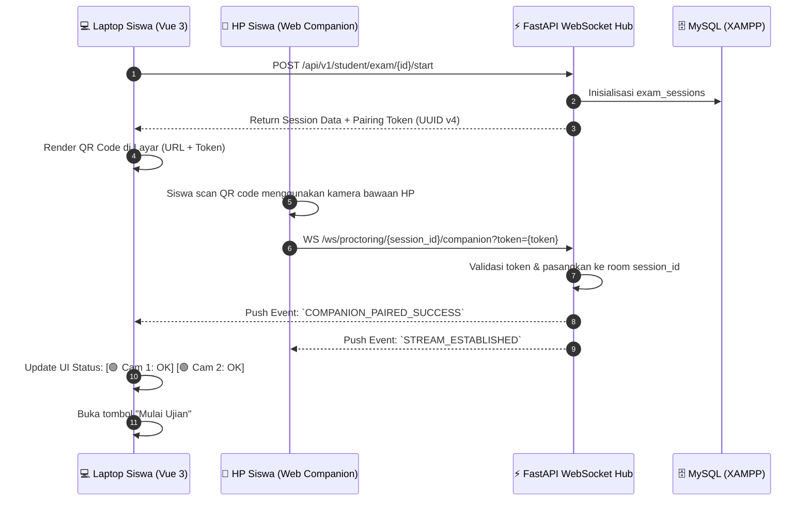
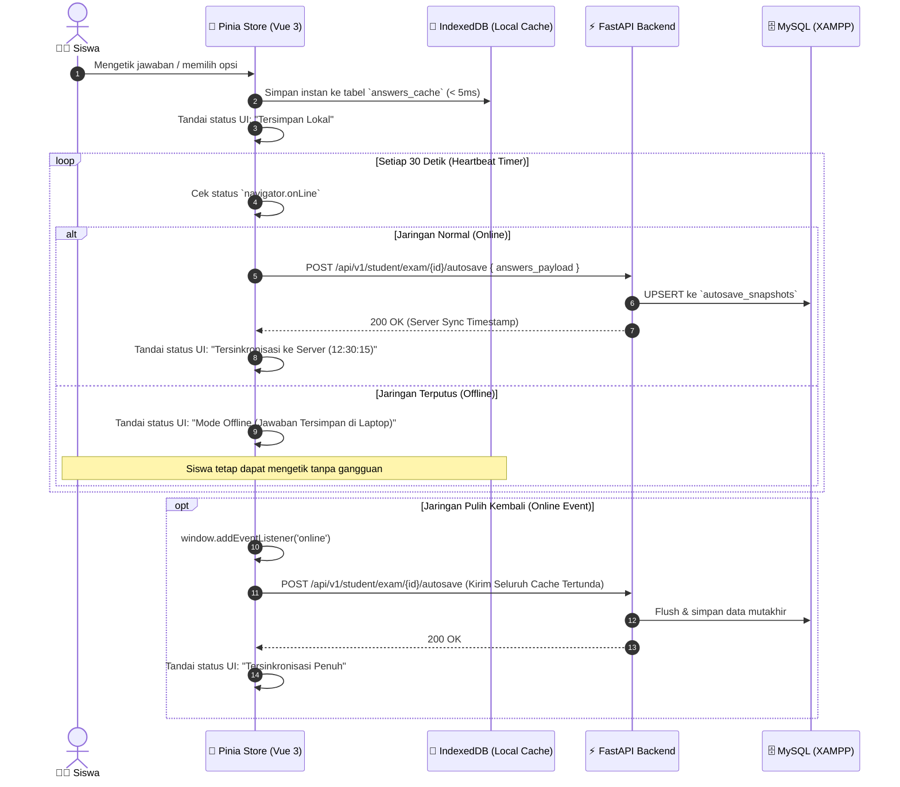

# EXAMIND — System Architecture & Technical Specifications

**Versi:** 1.2 (Tech Stack Migration: Vue 3 + FastAPI + PyTorch)  
**Tanggal:** 2 September 2026  
**Dokumen Induk:** [docs/PRD.md](./PRD.md) | [docs/SRS.md](./SRS.md)  

---

## 1. Arsitektur Tingkat Tinggi (High-Level Architecture)

EXAMIND mengadopsi pola arsitektur **Monorepo Modular Decoupled**, di mana lapisan antarmuka pengguna (**Frontend Vue 3 + Vite**) dan lapisan backend API (**FastAPI + Pydantic + PyTorch Model Serving**) beroperasi secara independen namun terorkestrasi dalam satu repositori kerja.

```
┌────────────────────────────────────────────────────────────────────────────────────────┐
│                                   CLIENT ECOSYSTEM                                     │
│                                                                                        │
│   ┌─────────────────────────────────────────┐   ┌──────────────────────────────────┐   │
│   │    EXAMINEE DESKTOP / LAPTOP WEB APP    │   │    COMPANION MOBILE WEB (PHONE)  │   │
│   │  - Vue 3 (Composition API) + Vite       │   │  - Zero-install QR Web App       │   │
│   │  - Pinia State Store & Vue Router       │   │  - Secondary Camera Stream       │   │
│   │  - MediaPipe Face & Pose Edge Engine    │   │  - WSS / WebRTC Signaling        │   │
│   │  - Offline IndexedDB Autosave Cache     │   │                                  │   │
│   └────────────────────┬────────────────────┘   └─────────────────┬────────────────┘   │
└────────────────────────┼──────────────────────────────────────────┼────────────────────┘
                         │ HTTPS / REST (Port 3000 -> 8000)         │ WSS / WebSockets
                         ▼                                          ▼
┌────────────────────────────────────────────────────────────────────────────────────────┐
│                                   BACKEND FASTAPI                                      │
│                                                                                        │
│   ┌────────────────────────────────────────────────────────────────────────────────┐   │
│   │                               API GATEWAY LAYER                                │   │
│   │  - CORS Middleware (Vue 3 Origin)      - JWT Bearer Authentication             │   │
│   │  - Rate Limiter (SlowAPI)              - Request Validation (Pydantic v2)      │   │
│   └───────────────────────────────────────┬────────────────────────────────────────┘   │
│                                           │                                            │
│   ┌───────────────────────────────────────┴────────────────────────────────────────┐   │
│   │                        BUSINESS LOGIC & CORE SERVICES                          │   │
│   │  - ExamSessionManager                 - ProctoringEventDispatcher              │   │
│   │  - WebSocketHub (Live Monitoring)     - AutoGradingWorker (BackgroundTasks)    │   │
│   └───────────────────┬───────────────────────────────────────────┬────────────────┘   │
│                       │                                           │                    │
│   ┌───────────────────┴────────────────┐         ┌────────────────┴────────────────┐   │
│   │     MODEL SERVING & ML PIPELINE    │         │      SQLALCHEMY 2.0 ORM         │   │
│   │  - PyTorch CV Anomaly Inference    │         │  - Connection Pool (PyMySQL)    │   │
│   │  - Modular LLM Adapters (Gemini)   │         │  - Alembic Database Migrations  │   │
│   │  - Feature Extraction & Scoring    │         │                                 │   │
│   └───────────────────┬────────────────┘         └────────────────┬────────────────┘   │
└───────────────────────┼───────────────────────────────────────────┼────────────────────┘
                        │ Model Weights (.pt / .pth)                │ Port 3306
                        ▼                                           ▼
         ┌──────────────────────────────┐          ┌─────────────────────────────────┐
         │       PYTORCH MODELS         │          │   DATABASE LAYER (XAMPP MYSQL)  │
         │ - Face Mesh Landmark Scorer  │          │ - Database: `examind`           │
         │ - Desk Object Anomaly Model  │          │ - Tables: users, exams, logs    │
         └──────────────────────────────┘          └─────────────────────────────────┘
```

---

## 2. Diagram Alur & Protokol Kunci (Key Workflows & Sequence Diagrams)

### 2.1 Alur Handshake Pairing Kamera HP Sekunder (Companion QR Handshake)



---

### 2.2 Alur Autosave Berlapis & Toleransi Putus Jaringan (Offline-First Resilience)



---

## 3. Spesifikasi Komputer Vision & Model Serving (PyTorch & Edge CV)

Sistem mengombinasikan **Edge Vision di sisi klien (MediaPipe WASM)** untuk deteksi berlatensi rendah dengan **Model Serving PyTorch di sisi server** untuk verifikasi snapshot berkualitas tinggi:

```
+------------------------+-------------------------+----------------------+---------------------------+
| TIPE PELANGGARAN       | SUMBER KAMERA           | HEURISTIK DETEKSI    | AMBANG BATAS & VERIFIKASI |
+------------------------+-------------------------+----------------------+---------------------------+
| Wajah Hilang (Absent)  | Cam 1 (Laptop)          | Bounding box = 0     | Durasi > 10 detik         |
| Wajah Ganda (Multiple) | Cam 1 (Laptop)          | Bounding box >= 2    | Confidence > 80%          |
| Tatapan Menyimpang     | Cam 1 (Laptop)          | |Yaw| > 35° / Pitch  | Durasi > 15 detik         |
| Tab Switch / Blur      | Window Listener (Vue 3) | visibilityState      | Seketika saat blur        |
| Objek Terlarang (HP)   | Cam 2 (Smartphone HP)   | PyTorch Object Model | Deteksi HP/kertas meja    |
+------------------------+-------------------------+----------------------+---------------------------+
```

---

## 4. Struktur Database Relasional (MySQL via XAMPP)

Sistem menggunakan **8 tabel relasional utama** yang terkelola via SQLAlchemy 2.0:
1. `users`: Manajemen akun pengguna multi-peran (`admin`, `teacher`, `student`).
2. `classes` & `class_members`: Struktur kelas dan keanggotaan siswa.
3. `question_banks` & `questions`: Bank soal per mata pelajaran dengan rubrik 4 dimensi JSON.
4. `exams` & `exam_questions`: Konfigurasi paket ujian dan alokasi poin soal.
5. `exam_sessions`: Sesi pengerjaan ujian aktif dengan skor integritas.
6. `student_answers`: Rekaman jawaban siswa, auto-score AI, override guru, dan penjelasan formatif.
7. `autosave_snapshots`: Cadangan snapshot jawaban utuh per sesi siswa.
8. `proctoring_logs`: Rekaman insiden pelanggaran pengawasan dengan URL snapshot terkompresi.

---

## 5. Konfigurasi Port & Komunikasi Monorepo

| Service | Port | Teknologi | URL Akses |
|---|---|---|---|
| **Frontend Web App** | `3000` (atau `5173`) | Vue 3 + Vite + TypeScript | `http://localhost:3000` |
| **Backend REST & WS** | `8000` | FastAPI + Uvicorn | `http://localhost:8000` (Docs: `/docs`) |
| **Database Server** | `3306` | MySQL (via XAMPP) | `mysql://root:@localhost:3306/examind` |
| **Database GUI Admin** | `80` | phpMyAdmin (via XAMPP Apache) | `http://localhost/phpmyadmin` |
