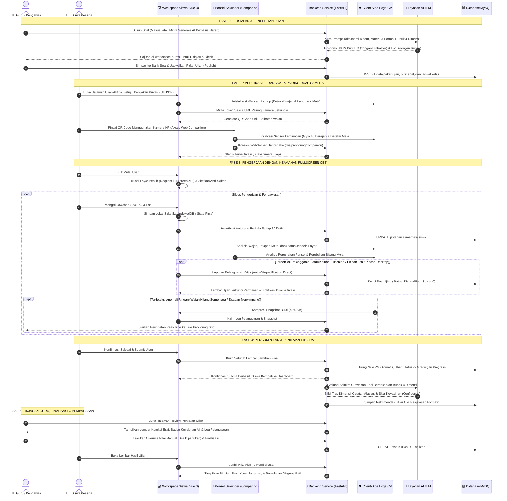
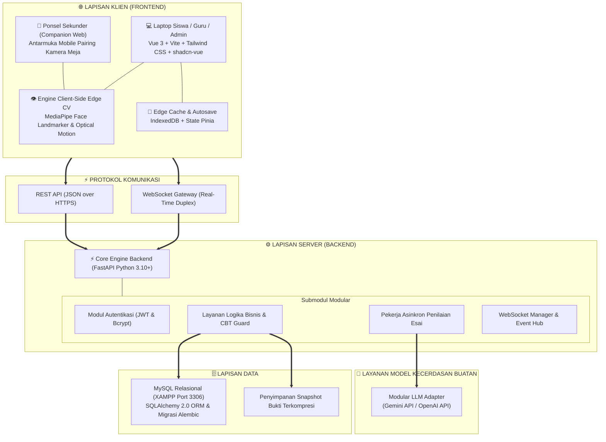
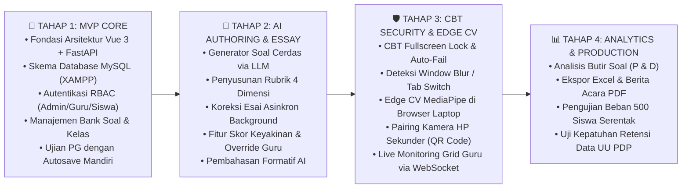

# Product Requirements Document (PRD)
# EXAMIND — Platform Penyelenggaraan Ujian Online Cerdas Berbasis AI

**Versi:** 2.0 (Arsitektur Terintegrasi: Vue 3 + FastAPI + Client-Side Edge AI)  
**Tanggal Rilis Dokumen:** September 2026  
**Status Dokumen:** Dokumen Spesifikasi Produk Disetujui (Approved Product Specification)  
**Klasifikasi:** Rekayasa Perangkat Lunak Akademik & Institusional  

---

## 1. Ringkasan Eksekutif & Latar Belakang

### 1.1 Visi & Pernyataan Misi Produk
**EXAMIND** adalah platform penyelenggaraan ujian online (*Computer-Based Testing / CBT*) generasi baru yang dirancang khusus untuk sekolah menengah (SMP, SMA, SMK) dan institusi pendidikan formal. EXAMIND mentransformasikan seluruh siklus ujian dalam satu ekosistem terpadu:
1. **Pembuatan Soal Cerdas**: Memanfaatkan model kecerdasan buatan (*AI Question Generator*) untuk menyusun butir soal pilihan ganda beserta rasional distraktor dan soal esai dengan rubrik penilaian multidimensi berdasarkan materi ajar guru.
2. **Pengawasan Ujian Dual-Camera Berintegritas Tinggi**: Menggabungkan kamera primer (webcam laptop) dan kamera sekunder (ponsel pintar siswa) dengan teknologi *Client-Side Edge Computer Vision* untuk mendeteksi anomali ruang ujian tanpa melanggar privasi visual peserta.
3. **Keamanan Lingkungan CBT Tanpa Kompromi**: Menerapkan kunci layar penuh (*fullscreen gate*) otomatis dan pendeteksi pengalihan fokus jendela (*tab / virtual desktop switch*) dengan mekanisme diskualifikasi otomatis (*auto-fail*) seketika saat terjadi pelanggaran fatal.
4. **Penilaian Hibrida & Asinkron**: Penilaian instan untuk pilihan ganda serta penilaian esai berbantuan AI dengan skor keyakinan (*confidence level*) dan wewenang mutlak guru untuk melakukan peninjauan ulang serta penyesuaian nilai (*human-in-the-loop*).
5. **Umpan Balik & Pembahasan Formatif**: Memberikan analisis konseptual mendalam bagi siswa mengenai letak kesalahan berpikir dan penguatan materi setelah ujian selesai.
6. **Dashboard Analitik Terpusat**: Menyediakan diagnosis butir soal (tingkat kesukaran dan daya pembeda), rekapitulasi nilai kelas, dan pencetakan berita acara resmi bagi guru dan pimpinan sekolah.

---

### 1.2 Analisis Permasalahan & Solusi Produk

| Masalah Konvensional | Dampak Terhadap Pendidikan | Solusi yang Dihadirkan EXAMIND |
|---|---|---|
| **Beban Administratif Guru Tinggi** Guru menghabiskan 10–15 jam per pekan untuk menyusun variasi soal dan mengoreksi ratusan lembar jawaban esai secara manual. | Guru mengalami kelelahan mental, keterlambatan umpan balik ke siswa hingga berminggu-minggu, dan berkurangnya waktu untuk pendampingan belajar. | **AI Question Generator & Async Essay Auto-Grading** memangkas waktu penyusunan soal dan koreksi esai hingga 75% dengan tetap mempertahankan kendali penuh guru. |
| **Titik Buta Pengawasan Satu Kamera** Webcam laptop hanya memantau wajah, tidak mampu melihat area meja kerja di mana ponsel pintar lain atau contekan fisik diletakkan. | Kejujuran akademik runtuh, kecurangan online terorganisir merajalela, dan hasil ujian kehilangan validitas ukur. | **Dual-Camera Proctoring** memanfaatkan ponsel pribadi siswa sebagai kamera pengawas meja tanpa instalasi aplikasi tambahan (*zero-install web pairing*). |
| **Beban Server Berat & Privasi Terancam** Sistem proctoring komersial mengalirkan seluruh video mentah ke cloud, membebani bandwidth sekolah dan melanggar privasi visual. | Biaya operasional melonjak, streaming video sering *buffering*, dan rekaman video rentan bocor ke pihak ketiga. | **Client-Side Edge Computer Vision** menjalankan inferensi visual di browser lokal perangkat peserta; server hanya menerima sinyal anomali terkompresi. |
| **Peralihan Tab & Joki Layar Terbuka** Peserta ujian dengan mudah membuka tab browser baru, mencari jawaban via search engine, atau berpindah desktop virtual. | Integritas ujian digital tidak dapat dipercaya oleh pihak pimpinan sekolah dan dinas pendidikan. | **CBT Fullscreen Lock & Auto-Fail Enforcement** mengunci layar penuh; jika siswa keluar fullscreen atau berganti tab/desktop, sistem langsung mendiskualifikasi ujian secara otomatis. |
| **Siswa Hanya Menerima Skor Angka** Hasil ujian tradisional hanya berupa angka akhir tanpa penjelasan mengapa suatu jawaban salah atau benar. | Siswa tidak memahami miskonsepsi konsep yang dialami; proses ujian gagal berfungsi sebagai sarana evaluasi belajar formatif. | **Formative Explanation Engine** menyajikan penjelasan personal mengapa jawaban salah serta merekomendasikan konsep yang perlu dipelajari kembali. |

---

### 1.3 Batasan Ruang Lingkup Sistem (Scope Boundaries)

Untuk memastikan keunggulan fokus produk pada fungsi ujian (*assessment excellence*), batasan berikut ditetapkan secara tegas:
- **Bukan Sistem Manajemen Pembelajaran (LMS) Menyeluruh**: EXAMIND tidak mencakup modul absensi harian kelas non-ujian, forum diskusi harian siswa, penugasan pekerjaan rumah bertingkat, atau repositori materi kuliah umum.
- **Bukan Sistem Informasi Akademik / Sekolah (SIS)**: EXAMIND tidak mengelola pembayaran SPP, administrasi kepegawaian guru, manajemen sarana prasarana sekolah, atau buku induk registrasi siswa.
- **Digital-First Tanpa Pemindaian Lembar Kertas (Paper OMR)**: Seluruh alur kerja dirancang murni digital (*paperless CBT*); pengoreksian lembar jawab komputer fisik berbasis kertas tidak didukung pada versi ini.

---

## 2. Profil & Kebutuhan Pengguna (User Personas)

### 2.1 Administrator Sekolah
- **Karakteristik**: Bagian tata usaha, staf kurikulum, atau tim IT sekolah yang bertanggung jawab atas kelancaran infrastruktur ujian.
- **Kebutuhan Utama**:
  - Mengelola data master sekolah: akun guru, akun siswa, dan pemetaan kelas.
  - Memantau penggunaan sumber daya sistem dan log aktivitas sekolah.
  - Mengunduh rekapitulasi nilai dan laporan kepatuhan akademik seluruh kelas dalam format standar (Excel/PDF).
- **Ekspektasi**: Kemudahan konfigurasi, manajemen hak akses berbasis peran (*Role-Based Access Control / RBAC*) yang aman, serta pemulihan data yang andal.

### 2.2 Guru / Pengawas Ujian
- **Karakteristik**: Pendidik mata pelajaran yang menyelenggarakan evaluasi berkala (Penilaian Harian, Ujian Tengah Semester, Ujian Akhir Semester).
- **Kebutuhan Utama**:
  - Menyusun paket soal secara efisien melalui bank soal mandiri atau generasi cerdas berbasis topik kurikulum.
  - Mengatur jadwal, durasi, aturan pengacakan nomor soal/opsi, serta konfigurasi tingkat ketat proctoring.
  - Mengawasi jalannya ujian secara langsung (*live monitoring grid*) dan mengirimkan teguran visual kepada peserta bermasalah.
  - Meninjau rekomendasi nilai esai dari AI, melihat tingkat keyakinan (*confidence score*), dan melakukan penyesuaian nilai manual jika diperlukan.
  - Membaca grafik analisis butir soal untuk mengevaluasi kualitas instrumen evaluasi.
- **Ekspektasi**: Interface yang ringkas, penghematan waktu koreksi esai, serta kepastian bahwa integritas ujian terlindungi dari kecurangan.

### 2.3 Siswa / Peserta Ujian
- **Karakteristik**: Peserta didik tingkat sekolah menengah yang mengerjakan ujian menggunakan laptop/komputer pribadi maupun laboratorium sekolah.
- **Kebutuhan Utama**:
  - Tampilan lembar ujian yang bersih, bebas gangguan, dan responsif.
  - Prosedur aktivasi kamera primer dan kamera ponsel pendamping yang mudah tanpa instalasi aplikasi rumit.
  - Perlindungan terhadap kehilangan data jawaban saat terjadi gangguan koneksi internet mendadak (*offline-first autosave*).
  - Akses terhadap hasil evaluasi dan pembahasan konsep setelah nilai diresmikan oleh guru.
- **Ekspektasi**: Keadilan ujian terjamin, kejelasan aturan waktu dan pelanggaran, serta transparansi penilaian.

---

## 3. Alur Proses Pengguna (End-to-End User Journey)

Berikut adalah diagram urutan alur kerja sistem dari fase persiapan, pelaksanaan, hingga pengumuman hasil:

---

## 4. Spesifikasi Kebutuhan Fungsional Produk

### 4.1 Modul Autentikasi & Manajemen Pengguna
1. **Pemisahan Peran Pengguna (*Role-Based Access Control*)**:
   - Sistem menyediakan tiga peran dengan hak akses terisolasi: Administrator, Guru, dan Siswa.
   - Autentikasi menggunakan JSON Web Token (JWT) dengan enkripsi kata sandi berbasis algoritma Bcrypt (cost factor 12).
2. **Manajemen Master Data oleh Administrator**:
   - Pendaftaran, pembaruan, dan penonaktifan akun pengguna secara individual maupun impor massal via file spreadsheet.
   - Manajemen rombongan belajar (kelas), penetapan wali kelas, dan pendaftaran siswa ke dalam kelas terkait.
3. **Pemberlakuan Sesi Aman**:
   - Setiap pengguna hanya dapat membuka satu sesi aktif per akun untuk mencegah pengerjaan paralel oleh pihak luar.

---

### 4.2 Modul Bank Soal & AI Question Generator
1. **Pengelolaan Bank Soal Mandiri**:
   - Guru dapat menyusun, mengelompokkan, dan menduplikasi bank soal berdasarkan mata pelajaran, jenjang, dan topik bahasan.
   - Mendukung format teks kaya (*rich text*), penulisan rumus matematika berbasis format LaTeX, dan penyisipan gambar ilustrasi.
2. **Pembuat Soal Cerdas Berbasis AI**:
   - Guru dapat memasukkan input berupa teks materi pembelajaran, ringkasan silabus, atau mengunggah dokumen ajar (PDF, DOCX, TXT).
   - Pengaturan parameter mencakup: tingkat kesulitan (mudah, sedang, sukar), target Taksonomi Bloom (C1 hingga C6), jumlah butir pilihan ganda, dan jumlah butir esai.
   - **Karakteristik Soal Pilihan Ganda**:
     - Menghasilkan 4 hingga 5 opsi jawaban (A–E) dengan satu kunci jawaban yang valid.
     - Menyertakan rasional distraktor (*distractor rationale*) untuk setiap opsi salah, menjelaskan letak kesalahan konsep opsi tersebut.
   - **Karakteristik Soal Esai & Rubrik 4 Dimensi**:
     - Setiap butir esai otomatis dilengkapi panduan jawaban ideal dan rubrik penilaian terstandar yang terbagi menjadi 4 dimensi:
       - *Dimensi 1: Kesesuaian Konsep Inti* (Bobot default 40%).
       - *Dimensi 2: Kedalaman dan Kelengkapan Argumen* (Bobot default 30%).
       - *Dimensi 3: Akurasi Terminologi Teknis dan Fakta* (Bobot default 15%).
       - *Dimensi 4: Kejelasan Struktur Logika dan Bahasa* (Bobot default 15%).
3. **Ruang Kerja Kurasi Guru (*Curation Workspace*)**:
   - Soal hasil generasi AI disajikan terlebih dahulu di ruang peninjauan guru sebelum disimpan ke database.
   - Guru memiliki kebebasan penuh untuk menyunting teks soal, mengganti opsi, menyesuaikan bobot rubrik, atau meminta regenerasi butir tertentu.

---

### 4.3 Modul Penjadwalan & Konfigurasi Paket Ujian
1. **Konfigurasi Parameter Ujian**:
   - Penetapan nama ujian, deskripsi instruksi, durasi waktu pengerjaan (dalam menit), serta jendela tanggal dan jam pelaksanaan.
   - Pemilihan kelas sasaran yang berhak mengakses paket ujian.
2. **Aturan Integritas & Keamanan Ujian**:
   - Fitur pengacakan urutan nomor soal untuk setiap peserta.
   - Fitur pengacakan urutan opsi pilihan ganda pada tiap peserta.
   - Pengaturan aktivasi fitur pengawasan: Mode Standar (Webcam Primer saja) atau Mode Pengawasan Ketat (Dual-Camera Laptop + HP).
   - Ambang toleransi pelanggaran dan kebijakan waktu toleransi keterlambatan masuk ujian.

---

### 4.4 Modul Verifikasi Perangkat & Pairing Dual-Camera
1. **Dialog Persetujuan Privasi Sesuai Regulasi**:
   - Menampilkan modal persetujuan eksplisit sebelum perangkat kamera diaktifkan, mematuhi Undang-Undang Perlindungan Data Pribadi (UU No. 27 Tahun 2022).
2. **Verifikasi Kamera Primer (Webcam Laptop)**:
   - Pengujian fungsi kamera laptop untuk memastikan wajah peserta teridentifikasi dengan pencahayaan yang memadai.
3. **Pemasangan Kamera Ponsel Pendamping (*Zero-Install Web Pairing*)**:
   - Sistem laptop menghasilkan kode QR dinamis yang terikat secara unik dengan sesi ujian peserta.
   - Peserta memindai kode QR menggunakan kamera ponsel tanpa perlu mengunduh aplikasi native dari app store.
   - Ponsel terhubung ke antarmuka web khusus pendamping (*Companion Interface*).
   - Antarmuka ponsel dilengkapi panduan kalibrasi sensor:
     - Membaca sensor orientasi giroskop/akselerometer untuk memastikan ponsel diletakkan miring dengan sudut sekitar $45^\circ$ menghadap area meja dan laptop.
     - Mengaktifkan fitur *Screen Wake Lock API* agar layar ponsel tidak mati (*sleep*) selama ujian berlangsung.
     - Mengirimkan sinyal deteksi visual bidang meja ke sistem utama.

---

### 4.5 Modul Pengerjaan Ujian & Keamanan Layar CBT
1. **Gerbang Layar Penuh Wajib (*Fullscreen Gate Enforcement*)**:
   - Soal ujian tidak akan ditampilkan sebelum peserta mengaktifkan mode layar penuh (*Full Screen Mode*).
   - Sistem menyembunyikan seluruh kontrol navigasi browser yang berpotensi disalahgunakan.
2. **Pencegahan Perpindahan Tab & Desktop (*Anti-Switch Detection*)**:
   - Sistem mendengarkan event *visibilitychange*, *blur*, dan perubahan resolusi viewport window browser secara real-time.
   - Jika peserta memencet tombol Alt+Tab, tombol Windows, membuka aplikasi lain, membagi layar (*split screen*), beralih virtual desktop, atau keluar dari mode fullscreen:
     - **Tindakan Otomatis**: Sistem langsung membatalkan sesi ujian seketika (*auto-fail / instant disqualification*).
     - Sesi ujian di database diubah statusnya menjadi didiskualifikasi dengan nilai nol.
     - Lembar ujian dikunci permanen dan peserta dikeluarkan dari ruang pengerjaan dengan menampilkan alasan pelanggaran keamanan yang tercatat.
3. **Penyimpanan Lokal Mandiri & Sinkronisasi Berkala (*Hybrid Autosave*)**:
   - Setiap kali peserta memilih opsi atau mengetikkan jawaban esai, data langsung disimpan ke penyimpanan lokal browser (IndexedDB / state Pinia) dalam hitungan milidetik.
   - Sistem mengirimkan paket sinkronisasi (*heartbeat sync*) ke server backend setiap 30 detik.
   - Jika terjadi kendala koneksi internet sesaat, siswa tetap dapat melanjutkan pengerjaan soal dan sistem akan menyinkronkan kembali seluruh jawaban segera setelah koneksi pulih tanpa kehilangan data jawaban.
4. **Alat Bantu Navigasi Soal**:
   - Kisi-kisi nomor soal dengan indikator status: Belum Dijawab (abu-abu), Sudah Terjawab (hijau), dan Ragu-Ragu (kuning).
   - Timer hitung mundur terpusat yang otomatis mengunci dan mengirimkan lembar ujian saat waktu habis.

---

### 4.6 Modul Pengawasan Cerdas Berbasis Client-Side Edge CV
1. **Komputasi Visual di Sisi Klien (*Edge Processing*)**:
   - Seluruh inferensi visi komputer berjalan langsung di browser pengguna menggunakan library visual modern tanpa mengirimkan video mentah secara terus-menerus ke server.
2. **Kamera Primer (Webcam Laptop)**:
   - Memantau kehadiran wajah (*Face Presence*): Mendeteksi jika wajah peserta tidak terlihat di depan kamera lebih dari 10 detik berturut-turut.
   - Mendeteksi multi-wajah (*Multiple Faces*): Memberikan peringatan jika terdeteksi dua orang atau lebih di dalam frame kamera.
   - Memantau arah tatapan mata (*Gaze Tracking*): Menghitung rasio simetri pupil dan sudut wajah untuk mendeteksi tatapan mata yang menyimpang ke luar layar lebih dari 15 detik.
3. **Kamera Sekunder (Ponsel Pendamping Meja)**:
   - Memantau perubahan piksel dan pergerakan di area meja (*Optical Motion Difference*) untuk mendeteksi gerakan tangan yang mencurigakan di luar jangkauan laptop.
   - Membaca telemetri orientasi ponsel untuk mendeteksi jika ponsel pengawas diangkat atau diubah posisinya dari sudut meja.
4. **Pencatatan Insiden & Minimalisasi Data**:
   - Jika terjadi anomali pengawasan, sistem klien mengambil satu frame snapshot foto terkompresi beresolusi efisien (ukuran file $< 50$ KB).
   - Snapshot beserta label jenis anomali dan cap waktu (*timestamp*) dikirimkan ke server untuk disimpan sebagai bukti verifikasi guru.

---

### 4.7 Modul Live Monitoring & Penanganan Pengawas
1. **Grid Pemantauan Real-Time Pengawas**:
   - Guru dapat melihat status seluruh siswa dalam satu kelas melalui tampilan petak (*monitoring grid*) yang diperbarui secara langsung via koneksi WebSocket.
   - Indikator status setiap siswa: Hijau (Normal/Aktif), Kuning (Terdeteksi Anomali Pengawasan), Merah (Terputus / Didiskualifikasi).
2. **Pemeriksaan Bukti Anomali**:
   - Guru dapat mengklik petak siswa yang ditandai untuk meninjau log snapshot insiden, jenis anomali, dan riwayat waktu kejadian.
3. **Kirim Peringatan Interaktif Langsung**:
   - Guru dapat mengirimkan pesan teguran resmi langsung ke layar ujian siswa tertentu secara instan (misal: "Posisi duduk tegak, jangan menunduk ke bawah meja").

---

### 4.8 Modul Penilaian Otomatis Hibrida & Review Guru
1. **Penilaian Deterministik Soal Pilihan Ganda**:
   - Soal pilihan ganda dievaluasi secara instan dengan kompleksitas waktu konstan $O(1)$ seketika saat lembar jawaban disubmit oleh siswa.
2. **Penilaian Asinkron Soal Esai Berbasis AI**:
   - Evaluasi jawaban esai diproses di latar belakang (*asynchronous background worker*) agar proses pengumpulan ujian siswa tidak mengalami *freezing* atau *timeout*.
   - AI mengevaluasi teks jawaban siswa terhadap rubrik 4 dimensi yang telah ditetapkan sebelumnya.
   - AI menghasilkan:
     - Skor per dimensi dan skor total yang dinormalisasi.
     - Penjelasan tertulis mengenai justifikasi mengapa nilai tersebut diberikan berdasarkan kriteria rubrik.
     - **Indeks Keyakinan Penilaian AI (*Confidence Score*)**:
       - *Kategori Tinggi ($\ge 85\%$)*: Jawaban siswa sangat terstruktur dan cocok secara semantik dengan kunci rubrik.
       - *Kategori Sedang ($70\% - 84\%$)*: Terdapat variasi struktur bahasa atau argumen parsial.
       - *Kategori Rendah ($< 70\%$)*: Format jawaban ambigu atau minim kesesuaian kata kunci; sistem memberikan tanda prioritas (*flag*) agar guru memeriksa secara khusus.
3. **Kendali Penuh Guru (*Human-in-the-Loop Override*)**:
   - Rekomendasi nilai dari AI bersifat asistif; guru memiliki wewenang penuh untuk mengubah skor angka tiap dimensi, memperbarui skor akhir, dan menambahkan catatan evaluasi personal sebelum nilai difinalisasi.

---

### 4.9 Modul Pembahasan & Umpan Balik Formatif AI
1. **Umpan Balik Dua Sudut Pandang (*Dual-Perspective Feedback*)**:
   - **Untuk Jawaban Benar**: Sistem memberikan apresiasi, merangkum poin kunci keberhasilan argumen, dan memberikan wawasan pengayaan materi terkait.
   - **Untuk Jawaban Salah**: Sistem mendiagnosis akar kesalahpahaman konsep (*misconception diagnosis*), membedah bagian materi yang terlewat, dan menyajikan langkah penalaran yang tepat tanpa sekadar membagikan jawaban instan.
2. **Kebijakan Publikasi Pembahasan**:
   - Guru dapat mengatur waktu terbit pembahasan: dapat dilihat langsung setelah siswa selesai submit, atau baru dapat dibuka bersama-sama setelah seluruh sesi ujian satu kelas resmi ditutup.

---

### 4.10 Modul Analisis Butir Soal & Pelaporan Nilai
1. **Analisis Kualitas Instrumen Ujian (*Item Analysis*)**:
   - Perhitungan **Tingkat Kesukaran Butir Soal ($P$)**: Mengelompokkan soal ke dalam kategori Mudah, Sedang, atau Sukar berdasarkan proporsi siswa yang menjawab benar.
   - Perhitungan **Daya Pembeda Butir Soal ($D$)**: Mengukur efektivitas butir soal dalam membedakan kelompok siswa berkemampuan tinggi (*upper group*) dan kelompok berkemampuan rendah (*lower group*).
   - Identifikasi distraktor pilihan ganda yang tidak berfungsi (tidak pernah dipilih oleh siswa).
2. **Ekspor Rekapitulasi & Berita Acara**:
   - Ekspor rekap nilai kelas ke dalam format spreadsheet Excel (`.xlsx`) yang rapi dan siap diunggah ke sistem rapor sekolah.
   - Pencetakan dokumen Berita Acara Pelaksanaan Ujian dalam format PDF resmi lengkap dengan rekap kehadiran, durasi rata-rata, dan log integritas pengawasan.

---

## 5. Arsitektur Teknis & Pemilihan Teknologi

Berikut diagram arsitektur komponen platform EXAMIND:

### 5.1 Rincian Pemilihan Komponen Teknologi

| Komponen Arsitektur | Teknologi Terpilih | Justifikasi Teknis & Keunggulan |
|---|---|---|
| **Kerangka Frontend** | **Vue 3 (Composition API) + TypeScript** | Memberikan kejelasan struktur kode, reaktivitas performa tinggi, modularitas berbasis komponen, dan *type-safety* ketat yang meminimalisir bug saat kompilasi. |
| **Peralatan Build Frontend** | **Vite** | Menyediakan proses *bundling* instan, kecepatan *Hot Module Replacement (HMR)* dalam hitungan milidetik, dan hasil kompilasi produksi yang sangat ramping. |
| **Komponen UI & Styling** | **Tailwind CSS + shadcn-vue (Radix Vue)** | Menyediakan sistem desain yang rapi, modern, konsisten, serta memenuhi kepatuhan aksesibilitas internasional (WCAG 2.1 AA) tanpa ketergantungan styling wrapper pihak ketiga yang kaku. |
| **State Management Klien** | **Pinia** | Pengelolaan status data reaktif terpusat yang ringan untuk menyimpan status autentikasi, daftar soal, jawaban sementara, dan status konektivitas. |
| **Penyimpanan Lokal Klien** | **IndexedDB & Browser Storage** | Menyimpan cadangan jawaban siswa secara *offline-first* di sisi peramban untuk menjamin nol kehilangan data saat koneksi terputus. |
| **Visi Komputer Sisi Klien** | **MediaPipe Face Landmarker & Canvas Optical Flow** | Menjalankan inferensi posisi wajah, iris mata, dan deteksi gerak meja langsung pada chip grafis (GPU/WebGL) perangkat siswa, menghemat bandwidth server secara drastis. |
| **Kerangka Backend** | **FastAPI (Python 3.10+)** | Memiliki performa asinkron setara Node.js/Go, validasi data otomatis menggunakan Pydantic v2, dokumentasi OpenAPI/Swagger bawaan yang interaktif, serta integrasi alami dengan ekosistem AI Python. |
| **Manajemen Database & ORM** | **MySQL (XAMPP Default Port 3306) + SQLAlchemy 2.0** | Memenuhi kewajiban arsitektur akademik kampus dengan integrasi database MySQL XAMPP yang stabil, dikelola melalui ORM modern SQLAlchemy 2.0 dan manajemen skema migrasi terstruktur via Alembic. |
| **Komunikasi Real-Time** | **Native WebSockets (FastAPI)** | Menyediakan kanal komunikasi dua arah berlatensi sangat rendah untuk pertukaran sinyal *heartbeat*, siaran peringatan pengawasan, dan pembaruan grid guru secara langsung. |
| **Layanan Bahasa AI (LLM)** | **Modular LLM Adapters (Google Gemini & OpenAI)** | Adapter modular yang memisahkan logika aplikasi dengan penyedia model bahasa, memungkinkan pergantian provider AI dengan mulus untuk kebutuhan generasi soal dan penilaian esai. |

---

## 6. Kepatuhan Regulasi, Keamanan & Privasi Data

### 6.1 Kepatuhan Terhadap Undang-Undang Perlindungan Data Pribadi (UU No. 27 Tahun 2022)
1. **Pemberitahuan & Persetujuan Eksplisit (*Explicit Informed Consent*)**:
   - Sebelum mengakses kamera primer dan kamera ponsel pendamping, sistem menampilkan formulir penjelasan transparan mengenai data apa saja yang diproses dan tujuan penggunaannya.
   - Peserta harus menekan persetujuan sadar sebelum masuk ke tahap ujian.
2. **Prinsip Minimalisasi Pengumpulan Data (*Data Minimization*)**:
   - EXAMIND tidak merekam atau mengalirkan video streaming secara terus-menerus ke server (*no continuous video streaming*).
   - Seluruh pemrosesan visual dilakukan di browser lokal peserta (*client-side edge processing*).
   - Data visual yang dikirim ke server hanyalah snapshot gambar statis terkompresi berukuran sangat kecil ($< 50$ KB) yang diambil secara spesifik saat terdeteksi anomali integritas ujian.
3. **Kebijakan Retensi & Pemusnahan Data Otomatis (*Auto-Pruning 60 Hari*)**:
   - Snapshot foto bukti pelanggaran disimpan di direktori terenkripsi dan otomatis dihapus permanen oleh sistem setelah 60 hari kalender sejak ujian dinyatakan selesai.

### 6.2 Integritas Sistem & Mitigasi Positif Palsu (*False Positive Guardrails*)
1. **Prinsip Keadilan Peserta (*Human-in-the-Loop Safeguard*)**:
   - Kecerdasan buatan dan algoritma proctoring visual **TIDAK PERNAH** diberikan kewenangan untuk menggugurkan atau mendiskualifikasi siswa secara sepihak atas dugaan visual (seperti batuk, posisi duduk miring, atau pencahayaan ruangan redup).
   - AI hanya berfungsi sebagai pencatat bukti objektif (*flagging tool*) dengan cap waktu dan foto anomali untuk diverifikasi secara adil oleh guru pengawas manusia.
2. **Pengecualian Diskualifikasi Fatal yang Jelas**:
   - Tindakan diskualifikasi otomatis (*auto-fail*) hanya diberlakukan untuk pelanggaran teknis CBT yang disengaja dan objektif, yaitu: menutup layar penuh (*exit fullscreen*), membuka jendela aplikasi lain, berganti virtual desktop, atau beralih tab peramban.

---

## 7. Kebutuhan Non-Fungsional (Non-Functional Requirements)

### 7.1 Performa & Skalabilitas Sistem
1. **Waktu Respons Antarmuka**:
   - Pemuatan halaman awal aplikasi web (*Initial Page Load*) di browser peserta di bawah 1.5 detik pada koneksi internet standar (10 Mbps).
   - Navigasi perpindahan antar butir soal berlangsung instan ($< 50$ milidetik) karena seluruh soal telah di-cache di memori browser.
2. **Kapasitas Beban Bersamaan (*Concurrency*)**:
   - Server backend mampu menangani hingga 500 siswa yang melakukan pengerjaan ujian serentak dalam satu klaster sekolah dengan tingkat penggunaan CPU server di bawah 70%.
   - Endpoint autosave berkala mampu memproses minimal 100 permintaan per detik (*requests per second*) tanpa lonjakan latensi di atas 200 ms.
3. **Efisiensi Komputasi Edge CV**:
   - Eksekusi model deteksi wajah di browser peserta dibatasi pada rentang sampling 500–1000 ms per frame untuk mencegah lonjakan konsumsi baterai dan pemanasan berlebih pada laptop peserta.

### 7.2 Keandalan & Toleransi Kesalahan (*Reliability & Fault Tolerance*)
1. **Ketahanan Jaringan Terputus**:
   - Peserta dapat terus membaca dan menjawab soal meskipun sambungan WiFi sekolah terputus selama beberapa menit.
   - Mekanisme sinkronisasi otomatis akan menyalurkan kembali seluruh jawaban yang tertunda segera setelah koneksi tersambung kembali (*idempotent retry mechanism*).
2. **Integritas Database**:
   - Menggunakan transaksi ACID pada setiap perubahan status penting sesi ujian untuk mencegah inkonsistensi data nilai.

### 7.3 Kompatibilitas Perangkat & Peramban
1. **Kompatibilitas Komputer Peserta / Guru**:
   - Mendukung peramban modern berbasis Chromium (Google Chrome versi 100+, Microsoft Edge versi 100+) dan Mozilla Firefox versi 105+ pada sistem operasi Windows, macOS, dan Linux.
2. **Kompatibilitas Ponsel Pendamping**:
   - Mendukung browser mobile Google Chrome untuk Android dan Safari untuk iOS tanpa memerlukan instalasi aplikasi native tambahan.

---

## 8. Metrik Keberhasilan Produk (Product Success Metrics)

| Dimensi Evaluasi | Metrik Kinerja Utama (KPI) | Target Keberhasilan |
|---|---|---|
| **Efisiensi Kerja Pendidik** | Waktu yang dibutuhkan guru untuk menyusun paket soal dan menilai jawaban esai satu kelas (35 siswa). | Turun minimal **70%** (dari rata-rata 12 jam menjadi di bawah 3.5 jam per paket ujian). |
| **Integritas & Keamanan Ujian** | Tingkat keberhasilan pencegahan kecurangan layar (pindah tab / split screen) dan titik buta meja. | **100%** upaya perpindahan tab/layar terdeteksi seketika; **0** celah titik buta meja kerja yang tidak terpantau kamera sekunder. |
| **Ketahanan Data Jawaban** | Insiden kehilangan data jawaban siswa akibat koneksi internet drop atau peramban tertutup mendadak. | **0% insiden kehilangan data** (*Zero Data Loss Guarantee*) berkat kombinasi IndexedDB offline cache dan autosave 30 detik. |
| **Akurasi Penilaian Esai AI** | Korelasi peringkat nilai antara penilaian rekomendasi AI dengan hasil penilaian manual guru (*Pearson Correlation*). | Mencapai koefisien korelasi $r \ge 0.88$ pada rubrik 4 dimensi. |
| **Kepuasan & Penerimaan Pengguna** | *System Usability Scale (SUS)* yang diisi oleh sampel guru dan siswa setelah masa uji coba implementasi. | Skor SUS minimal **$\ge 80$** (kategori *Excellent / Grade A*). |

---

## 9. Rencana Tahapan Rilis & Roadmap Pengembangan

### Rincian Rencana Implementasi

1. **Tahap 1: Fondasi Inti Sistem & Evaluasi Pilihan Ganda**
   - Penyiapan repositori frontend (Vue 3 + Vite) dan backend (FastAPI).
   - Konfigurasi database MySQL pada server lokal XAMPP beserta migrasi Alembic.
   - Implementasi modul autentikasi JWT dan pembagian hak akses (Admin, Guru, Siswa).
   - Pengelolaan kelas, bank soal pilihan ganda, dan lembar ujian dengan autosave lokal IndexedDB.

2. **Tahap 2: Kecerdasan Buatan Pembuatan Soal & Penilaian Esai**
   - Integrasi adapter penyedia model bahasa (LLM Adapter).
   - Pembangunan fitur generasi soal terstruktur dengan rasional distraktor dan rubrik penilaian 4 dimensi.
   - Pembangunan antarmuka kurasi guru untuk peninjauan hasil AI sebelum disimpan.
   - Pipeline penilaian esai di latar belakang dengan perhitungan skor keyakinan (*confidence index*).
   - Antarmuka tinjauan guru untuk melakukan *manual score override* dan publikasi pembahasan formatif.

3. **Tahap 3: Keamanan Layar Penuh CBT & Pengawasan Dual-Camera**
   - Implementasi gerbang fullscreen wajib dengan pendeteksi pengalihan fokus jendela peramban (*auto-fail on blur/tab switch*).
   - Integrasi MediaPipe Face Landmarker di peramban laptop untuk pemantauan wajah dan arah tatapan mata.
   - Pengembangan antarmuka mobile pendamping berbasis web dengan pemindaian QR code dan kalibrasi kemiringan giroskop $45^\circ$.
   - Saluran komunikasi WebSocket real-time untuk penyiaran log anomali dan dasbor pemantauan guru (*live proctoring grid*).

4. **Tahap 4: Analisis Kualitas Soal, Pelaporan & Hardening Sistem**
   - Algoritma analisis butir soal: Tingkat Kesukaran ($P$) dan Daya Pembeda ($D$).
   - Ekspor rekapitulasi nilai ke format Microsoft Excel (`.xlsx`) dan pembuatan dokumen PDF Berita Acara Ujian.
   - Uji beban serentak (*stress testing*) dan pengujian keamanan injeksi serta enkripsi data.
   - Pengujian audit kepatuhan privasi data dan skrip pembersihan otomatis snapshot 60 hari.

---

Dokumen ini menjadi acuan spesifikasi tunggal (*single source of truth*) dalam pengembangan, pengujian, dan penjaminan mutu arsitektur platform **EXAMIND**.
