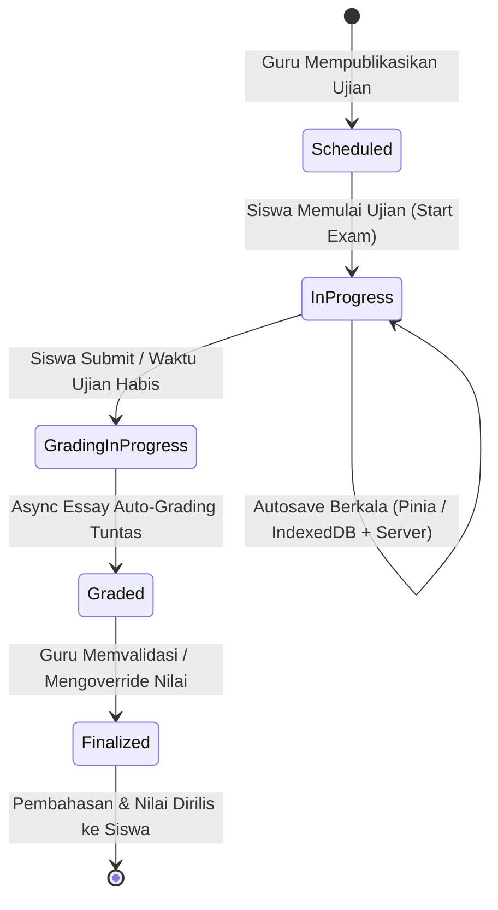

# Software Requirements Specification (SRS)
# Standar IEEE Std 830-1998 / ISO/IEC/IEEE 29148:2018

## Proyek: EXAMIND — Sistem Ujian Online & Pengawasan Cerdas Berbasis AI

**Nomor Dokumen:** SRS-EXAMIND-2026-V1.2  
**Versi:** 1.2 (Tech Stack Migration: Vue 3 + FastAPI + PyTorch)  
**Tanggal:** 2 September 2026  
**Status:** Approved for System Engineering & Development  
**Penulis / Tim:** EXAMIND Engineering Group  

---

## DAFTAR ISI
1. [1. Pendahuluan (Introduction)](#1-pendahuluan-introduction)
   - 1.1 Tujuan Dokumen (Purpose)
   - 1.2 Ruang Lingkup Produk (Scope of Product)
   - 1.3 Definisi, Akronim, dan Singkatan (Definitions, Acronyms, and Abbreviations)
   - 1.4 Referensi (References)
   - 1.5 Gambaran Umum Dokumen (Document Overview)
2. [2. Deskripsi Umum Sistem (Overall Description)](#2-deskripsi-umum-sistem-overall-description)
   - 2.1 Arsitektur & Perspektif Produk (Product Perspective)
   - 2.2 Fungsi-Fungsi Utama Produk (Product Functions)
   - 2.3 Karakteristik Pengguna (User Characteristics & Classes)
   - 2.4 Batasan Umum Desain & Implementasi (General Constraints)
   - 2.5 Asumsi dan Ketergantungan (Assumptions and Dependencies)
   - 2.6 Alokasi Kebutuhan per Tahapan Rilis (Apportioning of Requirements)
3. [3. Kebutuhan Spesifik (Specific Requirements)](#3-kebutuhan-spesifik-specific-requirements)
   - 3.1 Kebutuhan Antarmuka Eksternal (External Interface Requirements)
   - 3.2 Kebutuhan Fungsional (Functional Requirements — REQ-F)
   - 3.3 Kebutuhan Non-Fungsional (Non-Functional Requirements — REQ-NF)
   - 3.4 Kebutuhan Basis Data Logis (Logical Database Requirements)
4. [4. Matriks Keterlacakan Kebutuhan (Traceability Matrix)](#4-matriks-keterlacakan-kebutuhan-traceability-matrix)
5. [5. Lampiran & Model Perilaku Sistem (Appendix & System Behavioral Models)](#5-lampiran--model-perilaku-sistem-appendix--system-behavioral-models)

---

## 1. Pendahuluan (Introduction)

### 1.1 Tujuan Dokumen (Purpose)
Dokumen *Software Requirements Specification* (SRS) ini merinci seluruh spesifikasi kebutuhan fungsional dan non-fungsional untuk pengembangan sistem **EXAMIND (Sistem Ujian Online Berbasis AI)**. Dokumen ini disusun berdasarkan standar **IEEE Std 830-1998** (*Recommended Practice for Software Requirements Specifications*) dan ditujukan kepada:
- **Tim Pengembang Perangkat Lunak (Software Engineers)**: Sebagai acuan mutlak implementasi arsitektur frontend Vue 3, backend FastAPI, model serving PyTorch, basis data MySQL XAMPP, dan modul AI.
- **Tim Quality Assurance (QA) & Penguji**: Sebagai dasar penyusunan skenario pengujian (*test cases*) dan kriteria penerimaan sistem (*acceptance criteria*).
- **Pemangku Kepentingan Akademik (Dosen Pembimbing & Institusi Sekolah)**: Sebagai instrumen verifikasi kesesuaian sistem terhadap kebutuhan dunia pendidikan dan batasan akademik.

---

### 1.2 Ruang Lingkup Produk (Scope of Product)
Sistem perangkat lunak yang dispesifikasikan adalah **EXAMIND**, platform evaluasi akademik digital terintegrasi yang mencakup:
1. Pembuatan paket soal cerdas berbantuan AI (*AI Question Generator*) dengan analisis distraktor (*distractor analysis*) dan taksonomi Bloom.
2. Pengawasan ujian daring cerdas berbasis visi komputer (*AI Dual-Camera Proctoring*) menggunakan kamera laptop dan smartphone sekunder tanpa instalasi aplikasi native (*zero-install mobile companion*).
3. Penilaian otomatis hibrida (*Hybrid Auto-Grading*) yang mencakup evaluasi instan pilihan ganda dan penilaian esai berbasis *Large Language Model* (LLM) & ML Pipeline dengan rubrik 4 dimensi, skor keyakinan (*confidence index*), dan kewenangan koreksi manusia (*human-in-the-loop override*).
4. Pembangkitan penjelasan konseptual formatif (*Formative Answer Explanation*) bagi siswa.
5. Analitik hasil ujian, analisis butir soal (*item analysis*), serta pelaporan resmi institusi.

#### Batasan Produk (Non-Goals):
- Sistem **BUKAN** Learning Management System (LMS) penuh: Tidak mengelola forum diskusi, materi kuliah/sekolah mingguan, atau penugasan tugas harian.
- Sistem **BUKAN** School Information System (SIS): Tidak mengelola administrasi SPP, penggajian, atau buku induk kependudukan sekolah.
- Sistem **TIDAK** memproses pemindaian Lembar Jawaban Komputer (LJK) berbasis kertas fisik pada versi 1.0.

---

### 1.3 Definisi, Akronim, dan Singkatan (Definitions, Acronyms, and Abbreviations)

| Istilah / Akronim | Definisi |
|---|---|
| **Vue 3** | Framework JavaScript progresif berbasis Composition API untuk membangun antarmuka web modern reaktif. |
| **Vite** | Build tool dan server pengembangan frontend generasi berikutnya dengan performa tinggi dan instant HMR. |
| **Pinia** | Library manajemen state resmi dan modular untuk Vue 3. |
| **FastAPI** | Web framework asinkron modern berkinerja tinggi berbasis Python 3.10+ dan Pydantic v2. |
| **PyTorch** | Framework machine learning sumber terbuka yang digunakan untuk model serving dan eksekusi inferensi pipeline AI. |
| **AI (Artificial Intelligence)** | Kecerdasan buatan yang mengotomatisasi generasi soal, penilaian esai, dan analisis visual pengawasan. |
| **LLM (Large Language Model)** | Model bahasa besar (seperti Google Gemini atau OpenAI GPT) yang digunakan untuk pemahaman semantik esai dan penjelasan konsep. |
| **CV (Computer Vision)** | Teknologi penglihatan komputer (MediaPipe Face Mesh & PyTorch Models) untuk mendeteksi pose kepala, orientasi wajah, dan anomali visual. |
| **Human-in-the-Loop (HITL)**| Filosofi desain di mana keputusan final (misal diskualifikasi atau penentuan nilai akhir) tetap berada di bawah kendali manusia (guru/pengawas). |
| **Autosave** | Mekanisme penyimpanan otomatis jawaban siswa secara lokal (IndexedDB) dan tersinkronisasi ke server secara berkala untuk mencegah kehilangan data. |
| **UU PDP** | Undang-Undang Republik Indonesia Nomor 27 Tahun 2022 tentang Pelindungan Data Pribadi. |
| **JWT** | JSON Web Token, standar industri untuk transmisi klaim keamanan dan sesi autentikasi pengguna secara stateless. |
| **RBAC** | Role-Based Access Control, pembatasan hak akses sistem berdasarkan peran pengguna (`admin`, `teacher`, `student`). |
| **MCQ** | Multiple Choice Question (Pilihan Ganda). |
| **XAMPP** | Paket perangkat lunak penyedia server lokal Apache, PHP, dan MySQL/MariaDB yang menjadi basis hosting database relasional pada proyek ini. |

---

### 1.4 Referensi (References)
1. **IEEE Std 830-1998**: *IEEE Recommended Practice for Software Requirements Specifications*.
2. **ISO/IEC/IEEE 29148:2018**: *Systems and software engineering — Life cycle processes — Requirements engineering*.
3. **Undang-Undang Republik Indonesia No. 27 Tahun 2022**: *Tentang Pelindungan Data Pribadi (UU PDP)*.
4. **Dokumen Internal EXAMIND**:
   - [docs/PRD.md](./PRD.md) — Product Requirements Document (Master v1.2).
   - [docs/ARCHITECTURE.md](./ARCHITECTURE.md) — Technical & System Architecture Specifications.
   - [docs/AI_SPECIFICATION.md](./AI_SPECIFICATION.md) — AI & LLM Engine Specifications.
   - [docs/API_SPECIFICATION.md](./API_SPECIFICATION.md) — REST API & WebSocket Specifications.
   - [docs/UX_SPECIFICATION.md](./UX_SPECIFICATION.md) — UI & UX Design Specifications.
   - [docs/TEST_PLAN.md](./TEST_PLAN.md) — Test Plan & Quality Assurance Specifications.

---

## 2. Deskripsi Umum Sistem (Overall Description)

### 2.1 Arsitektur & Perspektif Produk (Product Perspective)
EXAMIND adalah sistem *independent self-contained* berbasis arsitektur Monorepo yang memisahkan Frontend Client (**Vue 3 + Vite**) dan Backend API (**FastAPI + Pydantic + PyTorch Model Serving**), serta terhubung ke basis data relasional **MySQL** yang dihosting pada environment XAMPP lokal.

```
┌────────────────────────────────────────────────────────┐
│                        FRONTEND                        │
│                                                        │
│  - Vue 3 + TypeScript                                  │
│  - Vite (Build Tool & Dev Server on Port 3000)         │
│  - Tailwind CSS + shadcn-vue (UI Components)           │
│  - Pinia (State Management: Auth, Exam, Proctoring)    │
│  - Vue Router (Client-side Routing & Auth Guards)      │
└───────────────────────────┬────────────────────────────┘
                            │ REST API / WebSockets / JSON
                            ▼
┌────────────────────────────────────────────────────────┐
│                        BACKEND                         │
│                                                        │
│  - FastAPI + Pydantic v2 (Port 8000)                   │
│  - Authentication (JWT + Bcrypt)                       │
│  - Business Logic Services (Exams, Questions, Grading) │
│  - Model Serving (PyTorch Inference Engine)            │
│  - ML Pipeline (Feature Extraction, Scoring, AI Hooks) │
└───────────────────────────┬────────────────────────────┘
                            │
                   ┌────────┴────────┐
                   ▼                 ▼
             MySQL (XAMPP)        PyTorch
               Port 3306          Models
```

---

### 2.2 Fungsi-Fungsi Utama Produk (Product Functions)

```mermaid
graph TD
    EXAMIND[Platform EXAMIND] --> F1[1. Penyusunan Soal Cerdas]
    EXAMIND --> F2[2. Pengawasan Ujian Dual-Camera]
    EXAMIND --> F3[3. Penilaian Hibrida & Override]
    EXAMIND --> F4[4. Penjelasan Jawaban Formatif]
    EXAMIND --> F5[5. Analitik & Pelaporan Kelas]

    F1 --> F1A[Generate Soal PG & Esai via AI]
    F1 --> F1B[Analisis Distraktor Pengecoh]
    F1 --> F1C[Generate Rubrik 4 Dimensi]
    F1 --> F1D[Manajemen Bank Soal]

    F2 --> F2A[Kamera Laptop: Deteksi Wajah, Tatapan, Tab Switch]
    F2 --> F2B[Kamera HP: Pairing QR Code Area Meja]
    F2 --> F2C[PyTorch Anomaly Verification & Snapshot Logging]
    F2 --> F2D[Live Grid Monitoring Guru & Broadcast Peringatan]

    F3 --> F3A[Penilaian PG Instan 0 Latensi]
    F3 --> F3B[Penilaian Esai Asinkron via ML & LLM Pipeline]
    F3 --> F3C[Perhitungan Indeks Keyakinan AI]
    F3 --> F3D[Human-in-the-Loop Teacher Override]

    F4 --> F4A[Diagnosis Miskonsepsi Jawaban Salah]
    F4 --> F4B[Penguatan Teori Jawaban Benar]
    F4 --> F4C[Kebijakan Rilis Terjadwal]

    F5 --> F5A[Analisis Butir Soal Tingkat Kesukaran & Daya Pembeda]
    F5 --> F5B[Histogram Distribusi Nilai & KPI Kelas]
    F5 --> F5C[Ekspor Resmi Excel & PDF Berita Acara]
```



---

### 2.3 Karakteristik Pengguna (User Characteristics & Classes)

| Kelas Pengguna | Deskripsi Peran & Tingkat Keahlian Teknis | Hak Akses & Tanggung Jawab Utama |
|---|---|---|
| **Administrator Sekolah (`admin`)** | Tim IT / Tata Usaha sekolah dengan keahlian teknis menengah. | Mengelola data master pengguna, penugasan kelas, pemeliharaan basis data, dan audit log integritas global. |
| **Guru (`teacher`)** | Tenaga pendidik mata pelajaran dengan keahlian teknis umum (pengguna web). | Membuat bank soal, menyusun jadwal ujian, memantau ujian real-time, mereview evaluasi AI, dan me-override nilai esai. |
| **Siswa (`student`)** | Peserta didik yang mengikuti ujian menggunakan laptop dan smartphone. | Melakukan verifikasi kamera ganda, mengerjakan soal ujian, memantau sisa waktu, dan membaca penjelasan jawaban pasca ujian. |

---

### 2.4 Batasan Umum Desain & Implementasi (General Constraints)
1. **Regulasi Lingkungan Basis Data**: Sesuai dengan spesifikasi penugasan akademik, sistem **wajib menggunakan basis data MySQL yang dilayani oleh XAMPP (Port 3306)**. Backend FastAPI berjalan independen sebagai proses Python standalone.
2. **Kepatuhan Privasi Data (UU PDP No. 27/2022)**: Seluruh pemrosesan rekaman visual kamera wajib didahului oleh dialog persetujuan (*explicit consent*). Video stream mentah tidak diunggah ke server; hanya snapshot frame terkompresi ($< 50$ KB) saat terjadi insiden pelanggaran yang disimpan dengan masa retensi maksimal 60 hari.
3. **Pemisahan Server (Decoupled Monorepo)**: Frontend berjalan pada port 3000 (Vue 3 + Vite) dan Backend pada port 8000 (FastAPI). Komunikasi lintas origin diatur oleh CORS Middleware.
4. **Resiliensi Jaringan Lemah**: Pengerjaan ujian wajib mendukung *offline-first autosave* menggunakan IndexedDB lokal (terintegrasi Pinia store) agar siswa di area dengan jaringan tidak stabil tidak kehilangan progres pengerjaan.

---

### 2.5 Asumsi dan Ketergantungan (Assumptions and Dependencies)
1. Perangkat laptop/desktop siswa memiliki webcam yang berfungsi dengan resolusi minimal 720p dan peramban web modern (Google Chrome, Microsoft Edge, Mozilla Firefox) yang mendukung WebAssembly dan WebRTC.
2. Smartphone pendamping siswa memiliki kamera belakang dan koneksi internet satu jaringan lokal atau terhubung ke server institusi.
3. Kunci API (*API Key*) untuk provider AI (Google Gemini / OpenAI) dan bobot model PyTorch telah terkonfigurasi pada backend.

---

### 2.6 Alokasi Kebutuhan per Tahapan Rilis (Apportioning of Requirements)
- **Fase 1 (MVP Core)**: Autentikasi JWT, Manajemen Kelas, Bank Soal dasar, Ujian PG dengan autosave Vue 3 dan penilaian instan.
- **Fase 2 (AI Essay & Explanation)**: Integrasi ML Pipeline & LLM, Rubrik 4 Dimensi, Async Essay Auto-Grading, Teacher Override, dan Formative Explanation.
- **Fase 3 (Smart Proctoring)**: Edge Face Mesh Webcam, Companion QR Pairing HP sekunder, PyTorch Model Serving verifikasi anomali, dan Live Monitoring Grid Guru.
- **Fase 4 (Analytics & Hardening)**: Item Analysis ($P$ & $D$), Ekspor Excel/PDF, dan Load Testing 100+ siswa.

---

## 3. Kebutuhan Spesifik (Specific Requirements)

### 3.1 Kebutuhan Antarmuka Eksternal (External Interface Requirements)

#### 3.1.1 Antarmuka Pengguna (User Interfaces)
- Antarmuka berbasis web responsif menggunakan **Vue 3 + Tailwind CSS + shadcn-vue** dengan kepatuhan standar aksesibilitas **WCAG 2.1 Level AA** (rasio kontras warna minimal 4.5:1).
- Antarmuka Siswa (*Student Exam Workspace*) beroperasi dalam mode layar penuh (*fullscreen*) bebas distraksi dengan panel navigasi nomor soal (kode warna hijau/kuning/abu-abu) dan Pinia reactive state.
- Antarmuka Guru (*Teacher Live Monitoring Hub*) menampilkan grid thumbnail status siswa dan workspace koreksi esai *side-by-side*.

#### 3.1.2 Antarmuka Perangkat Keras (Hardware Interfaces)
- **Kamera Primer (Webcam Laptop)**: Resolusi minimal $1280 \times 720$ piksel pada 15 FPS untuk inferensi deteksi wajah MediaPipe / Edge Vision.
- **Kamera Sekunder (Smartphone Camera)**: Akses streaming video HTML5 `getUserMedia({ video: { facingMode: "environment" } })`.

#### 3.1.3 Antarmuka Perangkat Lunak (Software Interfaces)
- **FastAPI Framework (v0.115+) & Pydantic v2**: Menangani routing HTTP REST API, validasi skema, dan server WebSocket.
- **PyTorch Model Serving & ML Pipeline**: Mengelola eksekusi model deep learning lokal untuk klasifikasi anomali visual dan verifikasi objek.
- **MySQL 8.0+ (via XAMPP)**: Mengelola penyimpanan data relasional transaksional via SQLAlchemy 2.0 ORM dengan driver `pymysql`.
- **LLM Provider API**: Protokol HTTPS REST ke Google Gemini API / OpenAI API dengan format respon terstruktur (*Structured Outputs JSON*).

#### 3.1.4 Antarmuka Komunikasi (Communications Interfaces)
- Protokol **HTTPS** (port 8000) untuk seluruh transaksi REST API dengan enkripsi TLS 1.3.
- Protokol **WSS (WebSocket Secure)** untuk transmisi real-time data status pengawasan dan broadcast peringatan guru.
- Format pertukaran data secara eksklusif menggunakan **JSON** (`Content-Type: application/json; charset=utf-8`).

---

### 3.2 Kebutuhan Fungsional (Functional Requirements)

```
Kategori Kode:
- REQ-F-AUTH : Modul Autentikasi & Pengguna
- REQ-F-QGEN : Modul Bank Soal & AI Generator
- REQ-F-EXAM : Modul Paket & Penjadwalan Ujian
- REQ-F-TAKE : Modul Pengerjaan Ujian Siswa
- REQ-F-PROC : Modul AI Dual-Camera Proctoring & PyTorch Serving
- REQ-F-GRAD : Modul AI Essay Grading & ML Pipeline
- REQ-F-EXPL : Modul Penjelasan Formatif Jawaban
- REQ-F-REP  : Modul Analitik & Pelaporan
```

#### 3.2.1 Modul Autentikasi & Pengguna (`REQ-F-AUTH`)
- **REQ-F-AUTH-01**: Sistem **harus** menyediakan antarmuka login yang mengautentikasi pengguna berdasarkan kombinasi `identifier` (NISN/NIP/Username/Email) dan kata sandi menggunakan enkripsi Bcrypt.
- **REQ-F-AUTH-02**: Sistem **harus** menerbitkan JSON Web Token (JWT) berumur masa aktif 1440 menit (24 jam) yang memuat klaim identitas `user_id` dan `role`.
- **REQ-F-AUTH-03**: Sistem **harus** menerapkan Role-Based Access Control (RBAC) pada setiap endpoint API dan Vue Router navigation guards guna membatasi akses sesuai peran (`admin`, `teacher`, `student`).
- **REQ-F-AUTH-04**: Sistem **harus** menyediakan fitur CRUD data kelas, penugasan guru pengampu, dan pendaftaran keanggotaan siswa ke dalam kelas akademik.

#### 3.2.2 Modul Bank Soal & AI Generator (`REQ-F-QGEN`)
- **REQ-F-QGEN-01**: Sistem **harus** menyediakan fitur pengelolaan Bank Soal per mata pelajaran dengan dukungan tipe soal Pilihan Ganda (PG), Esai Singkat, dan Esai Panjang.
- **REQ-F-QGEN-02**: Sistem **harus** menyediakan mesin AI Question Generator yang mampu mengekstrak teks materi atau dokumen (PDF/DOCX) dan menghasilkan paket draft soal berdasarkan tingkat kesulitan dan taksonomi Bloom (C1–C6).
- **REQ-F-QGEN-03**: Sistem **harus** menyertakan analisis rasional distraktor (*distractor rationale*) pada setiap opsi pengecoh soal pilihan ganda yang dihasilkan AI.
- **REQ-F-QGEN-04**: Sistem **harus** menghasilkan matriks Rubrik Penilaian 4 Dimensi (Konsep Inti 40%, Argumen 30%, Terminologi 15%, Logika 15%) secara otomatis untuk setiap butir soal esai.
- **REQ-F-QGEN-05**: Sistem **harus** menyediakan antarmuka kurasi guru berbasis Vue 3 untuk menyunting, menyetujui, meminta regenerasi butir, atau menghapus draft soal sebelum disimpan ke Bank Soal.

#### 3.2.3 Modul Paket & Penjadwalan Ujian (`REQ-F-EXAM`)
- **REQ-F-EXAM-01**: Sistem **harus** memungkinkan guru menyusun paket ujian dengan menentukan judul, durasi (menit), jadwal mulai/selesai, kelas target, tingkat pengawasan proctoring, dan kebijakan rilis pembahasan.
- **REQ-F-EXAM-02**: Sistem **harus** memvalidasi bahwa total alokasi poin seluruh butir soal dalam satu paket ujian bernilai tepat 100.00 poin.
- **REQ-F-EXAM-03**: Sistem **harus** menyediakan fitur pengacakan urutan soal (*question randomization*) dan pengacakan opsi pilihan ganda (*option shuffling*) yang konsisten per sesi siswa menggunakan algoritma *deterministic seeded randomizer*.
- **REQ-F-EXAM-04**: Sistem **harus** memungkinkan guru mempublikasikan ujian (*publish*) sehingga berstatus aktif dan dapat diakses siswa pada rentang waktu yang dijadwalkan.

#### 3.2.4 Modul Pengerjaan Ujian Siswa (`REQ-F-TAKE`)
- **REQ-F-TAKE-01**: Sistem **harus** memvalidasi jadwal ujian dan mencegah pembukaan sesi ujian ganda (*concurrent multi-session lock*) untuk satu akun siswa pada ujian yang sama.
- **REQ-F-TAKE-02**: Sistem **harus** menyediakan antarmuka ujian layar penuh (*fullscreen*) Vue 3 dengan countdown timer berbasis server, penampil soal Markdown/LaTeX, dan kisi-kisi nomor soal interaktif.
- **REQ-F-TAKE-03**: Sistem **harus** menerapkan mekanisme *Zero Data-Loss Autosave* yang menyimpan setiap perubahan jawaban ke IndexedDB lokal secara instan ($< 5$ ms) melalui Pinia store dan menyinkronkan data ke server secara periodik setiap 30 detik.
- **REQ-F-TAKE-04**: Sistem **harus** mengizinkan siswa tetap mengetik jawaban saat koneksi internet terputus (mode offline) dan secara otomatis menyinkronkan seluruh cache lokal ke server saat koneksi internet pulih.
- **REQ-F-TAKE-05**: Sistem **harus** mengevaluasi seluruh butir soal pilihan ganda secara instan di server saat siswa mengumpulkan ujian (*submit*) dan memperbarui status sesi menjadi `grading_in_progress`.

#### 3.2.5 Modul AI Dual-Camera Proctoring & PyTorch Serving (`REQ-F-PROC`)
- **REQ-F-PROC-01**: Sistem **harus** melakukan inferensi visi komputer di sisi klien (*edge browser*) pada webcam laptop siswa untuk mendeteksi wajah hilang ($> 10$s), wajah ganda ($\ge 2$), tatapan menyimpang ($> 15$s), dan tab switch / fullscreen blur.
- **REQ-F-PROC-02**: Sistem **harus** menyediakan mekanisme *QR Code Companion Pairing* yang memungkinkan smartphone siswa terhubung sebagai kamera sekunder tanpa instalasi aplikasi native.
- **REQ-F-PROC-03**: Sistem **harus** mengunggah frame snapshot JPEG terkompresi ($< 50$ KB) saat anomali terkonfirmasi, memverifikasinya melalui **PyTorch Model Serving** di backend, dan mencatat log ke `proctoring_logs`.
- **REQ-F-PROC-04**: Sistem **harus** menghitung skor Indeks Integritas Sesi ($I_{session}$) dengan nilai awal 100% dan menerapkan pengurangan poin penalti sesuai bobot keparahan insiden.
- **REQ-F-PROC-05**: Sistem **DILARANG** mendiskualifikasi siswa secara otomatis; sistem hanya mencatat bukti dan menyiarkan notifikasi ke dashboard guru.
- **REQ-F-PROC-06**: Sistem **harus** menyediakan Live Monitoring Grid pada dashboard guru via WebSocket dengan filter siswa terindikasi anomali dan fitur pengiriman pesan peringatan langsung (*direct broadcast warning*).

#### 3.2.6 Modul AI Essay Grading & ML Pipeline (`REQ-F-GRAD`)
- **REQ-F-GRAD-01**: Sistem **harus** menjalankan worker asinkron di latar belakang (*FastAPI BackgroundTasks*) untuk mengevaluasi jawaban esai siswa terhadap rubrik 4 dimensi menggunakan ML Pipeline & LLM segera setelah ujian dikumpulkan.
- **REQ-F-GRAD-02**: Sistem **harus** menghitung Skor Keyakinan AI (*Confidence Score* $C_{ai}$) berdasarkan kedekatan semantik, konsistensi sub-skor, dan keberadaan kata kunci esensial.
- **REQ-F-GRAD-03**: Sistem **harus** mengklasifikasikan tingkat keyakinan ke dalam kategori `high` ($\ge 0.85$), `medium` ($0.70 - 0.84$), dan `low` ($< 0.70$), di mana kategori `low` otomatis diprioritaskan di antrean review manual guru.
- **REQ-F-GRAD-04**: Sistem **harus** menyediakan antarmuka koreksi guru *side-by-side* (Vue 3) yang menampilkan jawaban siswa, pertimbangan rubrik AI, input override nilai, dan kolom catatan guru.
- **REQ-F-GRAD-05**: Sistem **harus** memprioritaskan nilai override guru di atas nilai rekomendasi AI untuk menentukan nilai akhir resmi siswa.

#### 3.2.7 Modul Penjelasan Formatif Jawaban (`REQ-F-EXPL`)
- **REQ-F-EXPL-01**: Sistem **harus** menghasilkan penjelasan formatif otomatis berbantuan AI yang mendiagnosis akar miskonsepsi untuk jawaban salah dan memberikan penguatan konsep untuk jawaban benar.
- **REQ-F-EXPL-02**: Sistem **harus** mengontrol visibilitas pembahasan berdasarkan kebijakan ujian (`instant` untuk rilis segera atau `after_exam_closed` untuk rilis setelah ujian kelas berakhir).

#### 3.2.8 Modul Analitik & Pelaporan Kelas (`REQ-F-REP`)
- **REQ-F-REP-01**: Sistem **harus** menghitung Tingkat Kesukaran ($P$) dan Daya Pembeda ($D$) untuk setiap butir soal ujian secara otomatis berdasarkan hasil seluruh peserta kelas.
- **REQ-F-REP-02**: Sistem **harus** menyajikan dashboard analitik visual yang memuat histogram kurva distribusi nilai, rata-rata kelas, standar deviasi, dan persentase ketuntasan KKM.
- **REQ-F-REP-03**: Sistem **harus** menyediakan fitur ekspor rekapitulasi nilai kelas ke dalam format spreadsheet Microsoft Excel (`.xlsx`) dan dokumen PDF Berita Acara Ujian resmi.

---

### 3.3 Kebutuhan Non-Fungsional (Non-Functional Requirements)

#### 3.3.1 Kebutuhan Kinerja (Performance Requirements — REQ-NF-PERF)
- **REQ-NF-PERF-01**: Waktu respon rata-rata (*average response time*) endpoint REST API standar **harus** $< 150$ milidetik pada kondisi beban normal.
- **REQ-NF-PERF-02**: Latensi operasi autosave ke IndexedDB lokal **harus** $< 5$ milidetik, dan waktu pemrosesan endpoint autosave di server **harus** $< 100$ milidetik (p95).
- **REQ-NF-PERF-03**: Pemrosesan batch penilaian esai asinkron untuk 1 kelas penuh (35-40 siswa) **harus** tuntas dalam waktu $< 45$ detik.
- **REQ-NF-PERF-04**: Sistem **harus** mampu melayani minimal **100 koneksi siswa aktif bersamaan** pada 1 server lokal XAMPP/FastAPI tanpa lonjakan penggunaan CPU $> 60\%$.

#### 3.3.2 Kebutuhan Keandalan & Toleransi Kesalahan (Reliability Requirements — REQ-NF-REL)
- **REQ-NF-REL-01**: Sistem **harus** menjamin *Zero Data-Loss* pada jawaban siswa melalui mekanisme sinkronisasi bertingkat (IndexedDB + Heartbeat Server Sync per 30 detik).
- **REQ-NF-REL-02**: Jika server mengalami restart mendadak, data sesi pengerjaan ujian yang sedang berlangsung **harus** dapat dipulihkan 100% dari rekaman snapshot basis data terakhir.
- **REQ-NF-REL-03**: Sisa waktu ujian siswa **harus** dihitung secara mutlak dari server (*server-anchored timestamp*), sehingga tindakan me-refresh browser tidak akan mereset atau memanipulasi waktu ujian.

#### 3.3.3 Kebutuhan Keamanan & Kepatuhan Privasi (Security Requirements — REQ-NF-SEC)
- **REQ-NF-SEC-01**: Seluruh kata sandi pengguna **harus** di-hash menggunakan algoritma **Bcrypt** dengan salt factor minimal 12 sebelum disimpan ke basis data.
- **REQ-NF-SEC-02**: Seluruh transmisi data antara klien dan server **harus** menggunakan protokol terenkripsi **HTTPS (TLS 1.3)** dan **WSS (Secure WebSocket)**.
- **REQ-NF-SEC-03**: Sistem **harus** mematuhi **UU No. 27 Tahun 2022 (UU PDP)** dengan mewajibkan persetujuan eksplisit (*explicit consent*) dari siswa sebelum mengakses perangkat kamera.
- **REQ-NF-SEC-04**: Seluruh snapshot visual proctoring **harus** memiliki masa retensi maksimal **60 hari** dan otomatis dihapus permanen dari media penyimpanan setelah periode tersebut berakhir.

#### 3.3.4 Kebutuhan Kemudahan Penggunaan & Portabilitas (Usability & Portability — REQ-NF-USE)
- **REQ-NF-USE-01**: Antarmuka pengerjaan ujian siswa **harus** memiliki skor System Usability Scale (SUS) minimal 80 (Grade A / Sangat Mudah).
- **REQ-NF-USE-02**: Frontend web **harus** dapat diakses secara mulus pada seluruh peramban web modern berbasis Chromium (Chrome, Edge), Firefox, dan Safari tanpa memerlukan plugin tambahan.

---

### 3.4 Kebutuhan Basis Data Logis (Logical Database Requirements)

Struktur data relasional MySQL EXAMIND terdiri atas 8 entitas utama dengan integritas referensial penuh:

```
┌─────────────────┐       ┌─────────────────┐       ┌─────────────────┐
│      users      │───1:N─┤  question_banks │───1:N─┤    questions    │
│  (id, role,...) │       │ (id, teacher,..)│       │(id, type, prompt)
└────────┬────────┘       └─────────────────┘       └────────┬────────┘
         │                                                   │
        1:N                                                 1:N
         │                                                   │
┌────────▼────────┐       ┌─────────────────┐       ┌────────▼────────┐
│      exams      │───1:N─┤  exam_sessions  │───1:N─┤ student_answers │
│ (id, duration..)│       │ (id, status,..) │       │(id, score, conf)│
└─────────────────┘       └────────┬────────┘       └─────────────────┘
                                   │
                                  1:N
                                   │
                          ┌────────▼────────┐
                          │ proctoring_logs │
                          │(id, event, snap)│
                          └─────────────────┘
```

---

## 4. Matriks Keterlacakan Kebutuhan (Traceability Matrix)

| Kode Kebutuhan (REQ-F) | Judul Kebutuhan | Tiket Terkait (docs/tickets/) | Skenario Pengujian (docs/TEST_PLAN.md) |
|---|---|---|---|
| `REQ-F-AUTH-01..03` | Autentikasi JWT & RBAC Guards | `AUTH-001`, `AUTH-002`, `AUTH-003` | UAT-AUTH: Login Valid & Token Expiry Redirection |
| `REQ-F-AUTH-04` | Manajemen Kelas & Roster | `AUTH-004` | UAT-AUTH: Pembuatan Kelas & Penugasan Siswa |
| `REQ-F-QGEN-01..05` | AI Question Generator & Rubrik | `QGEN-001`, `QGEN-002`, `QGEN-003`, `QGEN-004` | UAT-QGEN: Generasi Soal PG & Esai Bloom's Taxonomy |
| `REQ-F-EXAM-01..04` | Paket & Penjadwalan Ujian | `EXAM-001`, `EXAM-002`, `EXAM-003` | UAT-EXAM: 4-Step Exam Wizard & Randomization Shuffle |
| `REQ-F-TAKE-01..04` | Sesi Ujian & Autosave Offline | `TAKE-001`, `TAKE-002`, `TAKE-003` | Skenario 1 (Gherkin): Ketahanan Autosave saat Jaringan Putus |
| `REQ-F-TAKE-05` | Submit & Evaluasi PG Instan | `TAKE-004` | UAT-TAKE: Submit Final & Instan O(1) Scoring |
| `REQ-F-PROC-01..02` | Edge Face Mesh & Companion QR | `PROC-001`, `PROC-002` | Skenario 2 (Gherkin): Pairing Kamera HP via QR Code |
| `REQ-F-PROC-03..06` | PyTorch Anomaly Serving & Live Grid | `PROC-003`, `PROC-004` | UAT-PROC: Deteksi Wajah Hilang & Broadcast Peringatan |
| `REQ-F-GRAD-01..05` | Async Essay Grading & Override | `GRAD-001`, `GRAD-002`, `GRAD-003` | Skenario 3 (Gherkin): AI Essay Grading & Teacher Override |
| `REQ-F-EXPL-01..02` | Penjelasan Formatif AI | `EXPL-001`, `EXPL-002` | UAT-EXPL: Diagnosis Miskonsepsi & Rilis Pembahasan |
| `REQ-F-REP-01..03` | Item Analysis & Ekspor Laporan | `REP-001`, `REP-002`, `REP-003` | UAT-REP: Perhitungan Indeks P & D serta Ekspor Excel/PDF |

---

## 5. Lampiran & Model Perilaku Sistem (Appendix & System Behavioral Models)

### 5.1 Diagram State Machine Sesi Ujian Siswa



---

**LEMBAR PENGESAHAN DOKUMEN SRS**

| Peran | Nama Terang | Tanggal | Tanda Tangan |
|---|---|---|---|
| **Lead Software Architect** | EXAMIND Engineering Lead | 2 September 2026 | *[Disetujui]* |
| **Product Owner** | EXAMIND Product Team | 2 September 2026 | *[Disetujui]* |
| **Academic Supervisor** | Dosen Pembimbing Proyek | 2 September 2026 | *[Disetujui]* |
