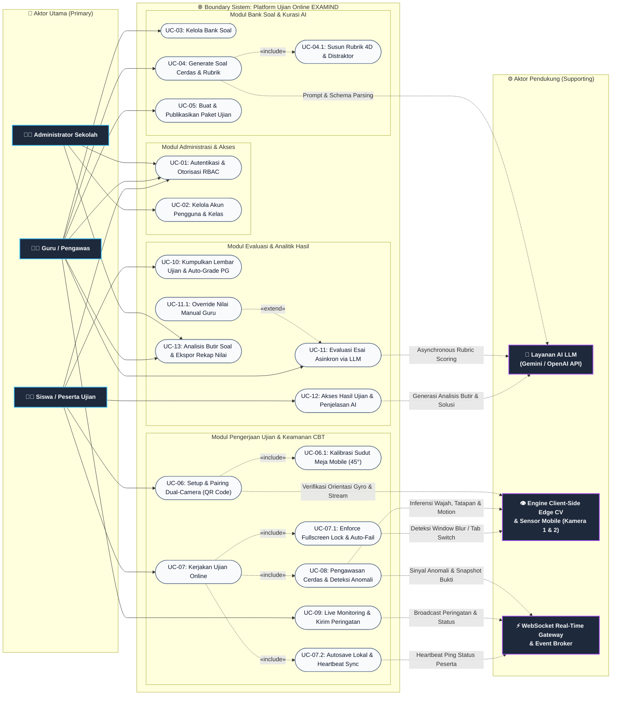
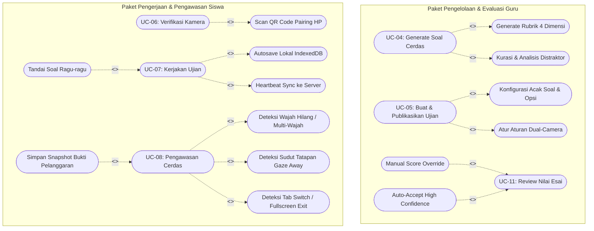
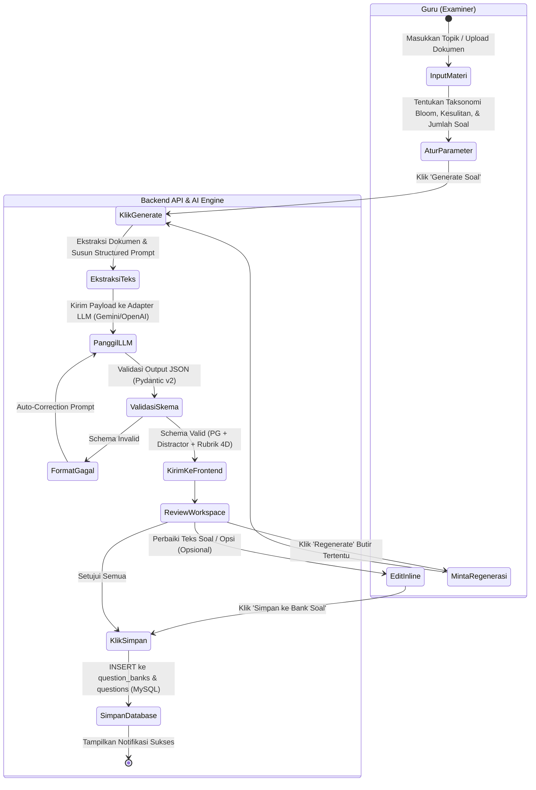
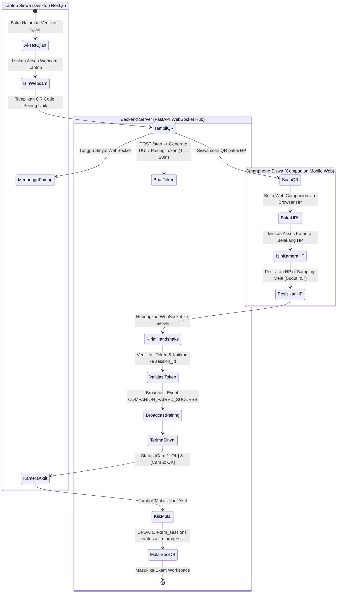
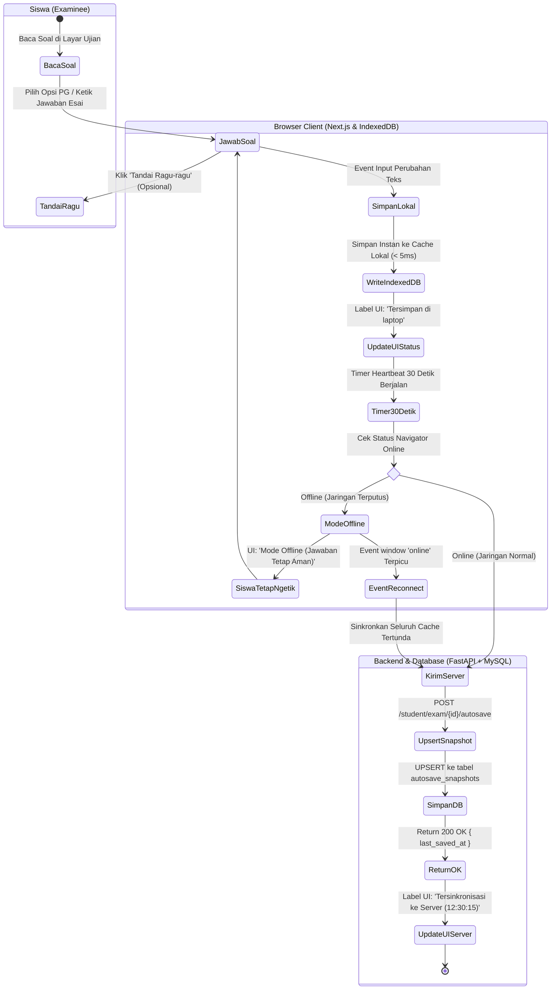
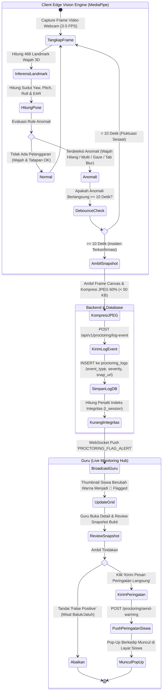
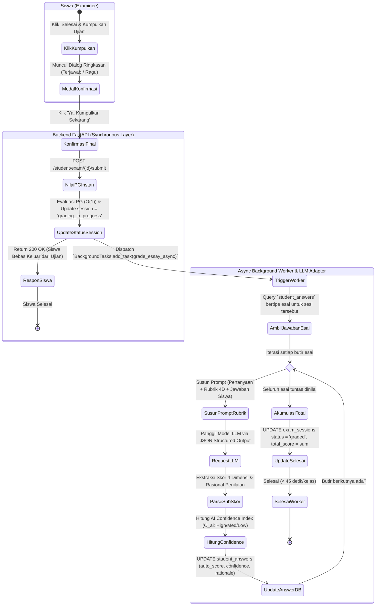
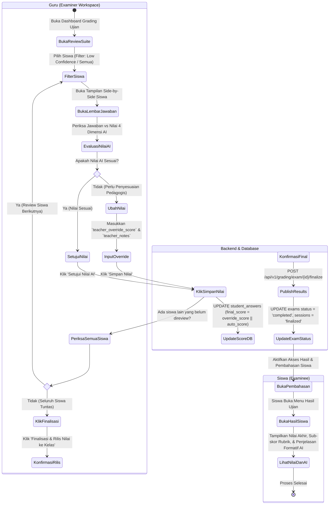

# EXAMIND — UML Use Case & Activity Diagrams Specification

**Versi:** 1.0 (Formal Software Modeling)  
**Tanggal:** 31 Agustus 2026  
**Dokumen Induk:** [docs/PRD.md](./PRD.md) | [docs/SRS.md](./SRS.md) | [docs/ARCHITECTURE.md](./ARCHITECTURE.md)  

---

## 1. UML Use Case Diagrams

### 1.1 Diagram Use Case Global Sistem (System-Level Use Case Diagram)

Diagram berikut memodelkan arsitektur Use Case formal EXAMIND sesuai kaidah UML menggunakan sintaks universal `flowchart LR`, memisahkan secara tegas antara **Aktor Utama (Primary Actors)** di sisi kiri dan **Aktor Pendukung (Supporting / Secondary Actors)** di sisi kanan:

*(Catatan: Digunakan format `flowchart LR` agar kompatibel 100% dengan seluruh markdown renderer seperti VSCode, GitHub, GitLab, Notion, dan browser tanpa dependensi engine eksperimental).*

---

### 1.2 Use Case Package: Rincian Hubungan `<<include>>` dan `<<extend>>`

---

### 1.3 Deskripsi Naratif Use Case Utama (Use Case Narratives)

#### Naratif UC-04: Generate Soal Cerdas & Rubrik via AI
- **Aktor**: Guru, Sistem AI (LLM Adapter).
- **Prasyarat**: Guru telah login dan memiliki hak akses aktif.
- **Alur Utama (Main Flow)**:
  1. Guru membuka menu AI Question Generator dan memasukkan topik/materi atau mengunggah dokumen PDF/DOCX.
  2. Guru memilih tingkat kesulitan, taksonomi Bloom (C1-C6), jumlah PG, dan jumlah Esai.
  3. Guru menekan tombol "Generate Soal".
  4. Backend memformat prompt terstruktur dan memanggil LLM Provider.
  5. AI menghasilkan butir soal PG (dengan distractor rationale) dan soal Esai (dengan Rubrik 4 Dimensi).
  6. Guru mereview hasil generate di Curation Workspace, mengedit teks yang diperlukan, dan mengklik "Simpan ke Bank Soal".
  7. Sistem menyimpan soal-soal tersebut ke database MySQL.
- **Alur Alternatif (Alternative Flow)**:
  - *4a. LLM API Rate Limit / Timeout*: Sistem menampilkan pesan error dan menawarkan opsi *Retry* atau beralih ke provider AI cadangan.

---

#### Naratif UC-06 & UC-08: Verifikasi Dual-Camera & Proctoring
- **Aktor**: Siswa, Smartphone Siswa, Guru Pengawas, Sistem AI (MediaPipe CV).
- **Prasyarat**: Siswa terdaftar pada ujian yang dijadwalkan dan berstatus `published`.
- **Alur Utama (Main Flow)**:
  1. Siswa login dan membuka ujian target di laptop.
  2. Laptop meminta izin webcam primer dan menampilkan QR Code pairing unik.
  3. Siswa memindai QR Code menggunakan browser kamera HP.
  4. HP terhubung ke WebSocket room ujian sebagai kamera sekunder yang mengawasi meja.
  5. Selama ujian, engine MediaPipe di laptop memantau wajah, tatapan, dan status fullscreen.
  6. Jika terjadi anomali (misal wajah hilang $>10$ detik), sistem mengambil snapshot terkompresi ($<50$ KB), mencatat log insiden, dan menyiarkannya ke grid guru.
- **Alur Alternatif (Alternative Flow)**:
  - *4a. HP terputus di tengah jalan*: Laptop menampilkan peringatan kuning `[⚠️ Cam 2 Disconnected]` dan memberi waktu toleransi 2 menit bagi siswa untuk me-refresh koneksi HP.

---

## 2. UML Activity Diagrams

---

### 2.1 Activity Diagram 1: AI Question Generation & Curation Flow

---

### 2.2 Activity Diagram 2: Dual-Camera Setup & QR Pairing Flow

---

### 2.3 Activity Diagram 3: Student Exam Taking, Offline Autosave & Reconnect Flow

---

### 2.4 Activity Diagram 4: Dual-Camera AI Proctoring & Flagging Flow

---

### 2.5 Activity Diagram 5: Exam Submission & Hybrid Async AI Grading Flow

---

### 2.6 Activity Diagram 6: Teacher Grading Review, Score Override & Finalization Flow

---

## 3. Matriks Keterlacakan Use Case ke Kebutuhan Fungsional (Traceability)

| Kode Use Case | Nama Use Case | Kebutuhan SRS Terkait ([docs/SRS.md](./SRS.md)) | Tiket Terkait ([docs/tickets/](../tickets/)) |
|---|---|---|---|
| **UC-01** | Autentikasi Login & Logout | `REQ-F-AUTH-01`, `REQ-F-AUTH-02`, `REQ-F-AUTH-03` | `AUTH-001`, `AUTH-002`, `AUTH-003` |
| **UC-02** | Kelola Pengguna & Kelas | `REQ-F-AUTH-04` | `AUTH-004` |
| **UC-03** | Kelola Bank Soal | `REQ-F-QGEN-01` | `QGEN-001` |
| **UC-04** | Generate Soal & Rubrik via AI | `REQ-F-QGEN-02`, `REQ-F-QGEN-03`, `REQ-F-QGEN-04`, `REQ-F-QGEN-05` | `QGEN-002`, `QGEN-003`, `QGEN-004` |
| **UC-05** | Buat & Publikasikan Ujian | `REQ-F-EXAM-01`, `REQ-F-EXAM-02`, `REQ-F-EXAM-03`, `REQ-F-EXAM-04` | `EXAM-001`, `EXAM-002`, `EXAM-003` |
| **UC-06** | Verifikasi Dual-Camera & QR Pairing | `REQ-F-PROC-02` | `PROC-002` |
| **UC-07** | Kerjakan Ujian & Autosave | `REQ-F-TAKE-01`, `REQ-F-TAKE-02`, `REQ-F-TAKE-03`, `REQ-F-TAKE-04` | `TAKE-001`, `TAKE-002`, `TAKE-003` |
| **UC-08** | Pengawasan Cerdas & Flagging | `REQ-F-PROC-01`, `REQ-F-PROC-03`, `REQ-F-PROC-04`, `REQ-F-PROC-05` | `PROC-001`, `PROC-003` |
| **UC-09** | Live Monitor & Kirim Peringatan | `REQ-F-PROC-06` | `PROC-004` |
| **UC-10** | Kumpulkan Ujian & Auto-Grading | `REQ-F-TAKE-05`, `REQ-F-GRAD-01`, `REQ-F-GRAD-02` | `TAKE-004`, `GRAD-001`, `GRAD-002` |
| **UC-11** | Review & Override Nilai Esai | `REQ-F-GRAD-03`, `REQ-F-GRAD-04`, `REQ-F-GRAD-05` | `GRAD-003` |
| **UC-12** | Lihat Hasil & Pembahasan AI | `REQ-F-EXPL-01`, `REQ-F-EXPL-02` | `EXPL-001`, `EXPL-002` |
| **UC-13** | Analisis Butir Soal & Ekspor | `REQ-F-REP-01`, `REQ-F-REP-02`, `REQ-F-REP-03` | `REP-001`, `REP-002`, `REP-003` |
