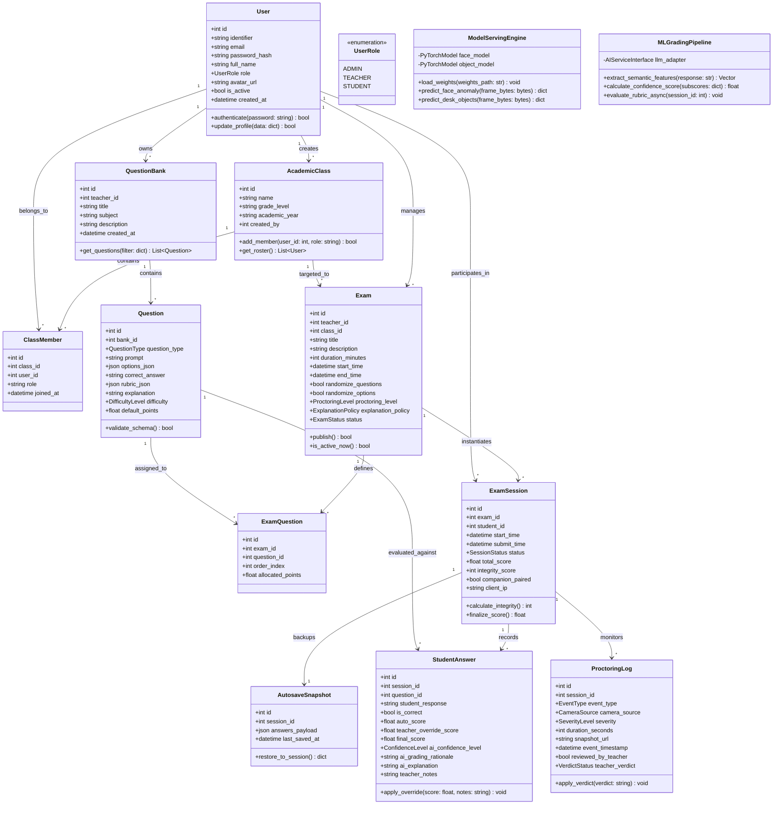
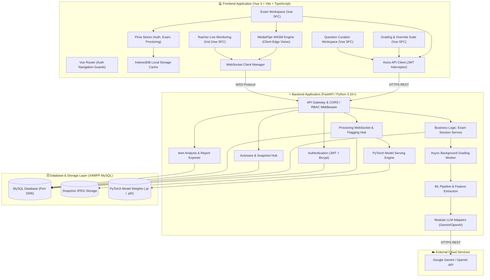
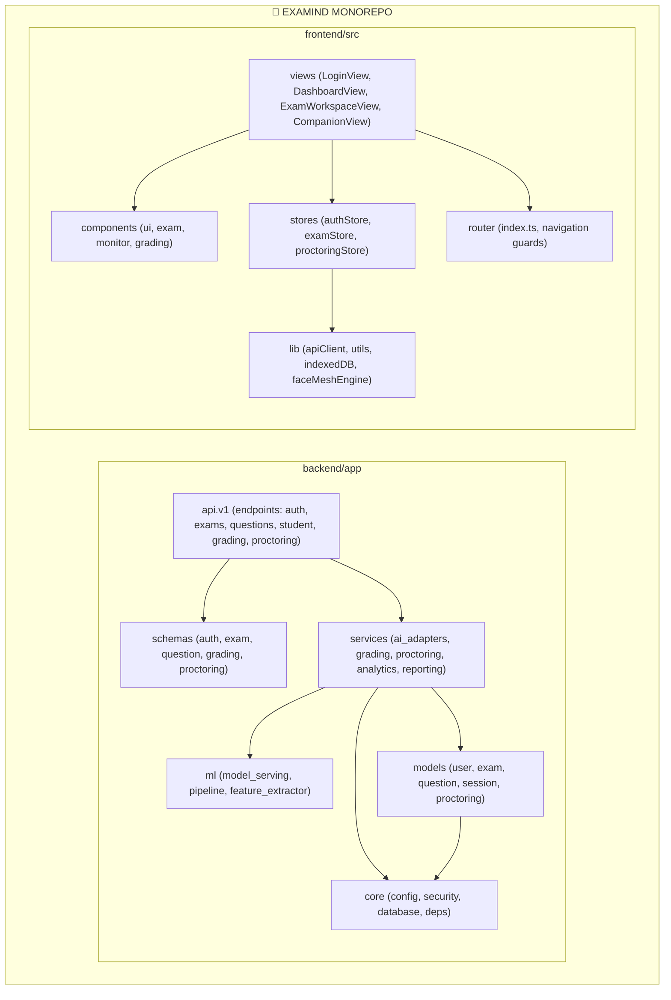
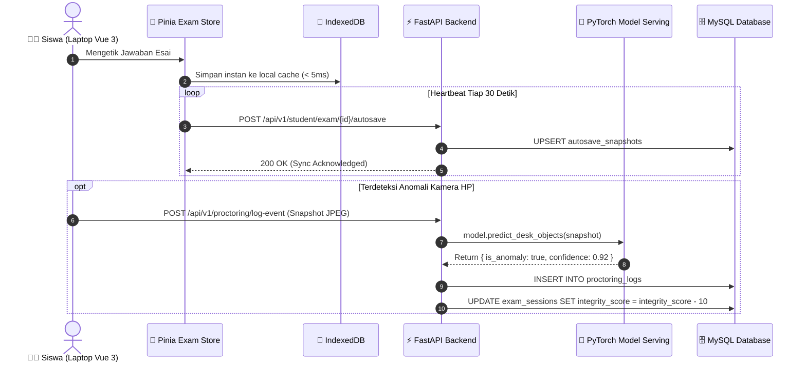
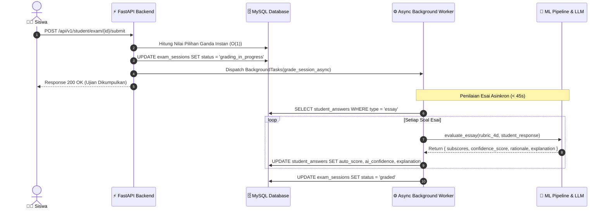

# EXAMIND — UML Structural & Behavioral Specifications

**Versi:** 1.2 (Tech Stack Migration: Vue 3 + FastAPI + PyTorch)  
**Tanggal:** 2 September 2026  
**Dokumen Induk:** [docs/PRD.md](./PRD.md) | [docs/SRS.md](./SRS.md) | [docs/ARCHITECTURE.md](./ARCHITECTURE.md)  

---

## DAFTAR ISI
1. [BAGIAN I: UML STRUCTURAL DIAGRAMS (DIAGRAM STRUKTURAL)](#bagian-i-uml-structural-diagrams)
   - 1.1 Class Diagram (Domain Model & Service Architecture)
   - 1.2 Component Diagram (Komponen Perangkat Lunak Monorepo)
   - 1.3 Deployment Diagram (Topologi & Node Distribusi Fisik)
   - 1.4 Package Diagram (Dekomposisi Paket Backend & Frontend)
2. [BAGIAN II: UML BEHAVIORAL DIAGRAMS (DIAGRAM PERILAKU)](#bagian-ii-uml-behavioral-diagrams)
   - 2.1 Use Case Diagram & Naratif
   - 2.2 Sequence Diagrams (Alur Transaksi Sistem Kunci)
   - 2.3 State Machine Diagrams (Siklus Hidup Entitas Kunci)
   - 2.4 Activity Diagrams (Alur Kerja Operasional dengan Swimlanes)

---

# BAGIAN I: UML STRUCTURAL DIAGRAMS

## 1.1 Class Diagram (Domain Model & Service Architecture)



---

## 1.2 Component Diagram (Komponen Perangkat Lunak Monorepo)



---

## 1.3 Deployment Diagram (Topologi & Node Distribusi Fisik)

```mermaid
graph TB
    subgraph Client_Laptop["🖥️ Node: Examinee Laptop / Desktop"]
        Browser_Desktop["Peramban Web (Chrome / Edge / Firefox)"]
        subgraph Exec_Desktop["Vue 3 SPA (Vite Bundle)"]
            WASM_CV["MediaPipe Face Mesh (WASM)"]
            IndexedDB_Local["IndexedDB Storage Cache"]
            Pinia_Engine["Pinia State Engine"]
        end
        Webcam_Device["📷 Hardware: HD Webcam (720p)"]
        Webcam_Device --> Browser_Desktop
    end

    subgraph Client_Phone["📱 Node: Examinee Smartphone (Companion)"]
        Browser_Mobile["Mobile Browser (Safari / Chrome)"]
        Mobile_Cam["📷 Hardware: Rear Camera (45° Meja)"]
        Mobile_Cam --> Browser_Mobile
    end

    subgraph Server_Host["🖥️ Node: Local Application Server (Host Machine)"]
        subgraph Process_FastAPI["Python 3.10+ Runtime Environment"]
            Uvicorn["ASGI Server: Uvicorn (Port 8000)"]
            FastAPI_App["FastAPI Application Instance"]
            Background_Worker["BackgroundTasks ThreadPool"]
            PyTorch_Runtime["PyTorch Inference Runtime (CPU/CUDA)"]
        end

        subgraph Process_XAMPP["XAMPP Server Environment"]
            MySQL_Server["MySQL 8.0+ Service (Port 3306)"]
            Apache_Admin["Apache (phpMyAdmin Port 80)"]
        end

        LocalStorage_Disk[("📁 Local Disk: /storage/snapshots/")]
        Model_Disk[("🧠 Model Weights: /models/*.pt")]
    end

    subgraph Cloud_AI["☁️ Node: AI Cloud Infrastructure"]
        Gemini_Cloud["Google AI Studio / Gemini Pro 1.5 Endpoint"]
    end

    %% Network Connections
    Browser_Desktop -->|HTTPS (Port 8000)| Uvicorn
    Browser_Desktop -->|WSS (Port 8000)| Uvicorn
    Browser_Mobile -->|WSS (Port 8000)| Uvicorn
    Uvicorn --> FastAPI_App
    FastAPI_App --> Background_Worker
    FastAPI_App --> PyTorch_Runtime
    PyTorch_Runtime --> Model_Disk
    FastAPI_App -->|TCP Connection Pool (Port 3306)| MySQL_Server
    FastAPI_App -->|Local I/O File Write| LocalStorage_Disk
    Background_Worker -->|TLS HTTPS Outbound| Gemini_Cloud
```

---

## 1.4 Package Diagram (Dekomposisi Paket Backend & Frontend)



---

# BAGIAN II: UML BEHAVIORAL DIAGRAMS

## 2.1 Sequence Diagram: Ujian Siswa, Autosave Vue 3 & Model Verification



---

## 2.2 Sequence Diagram: Submit & Async ML Grading Pipeline


