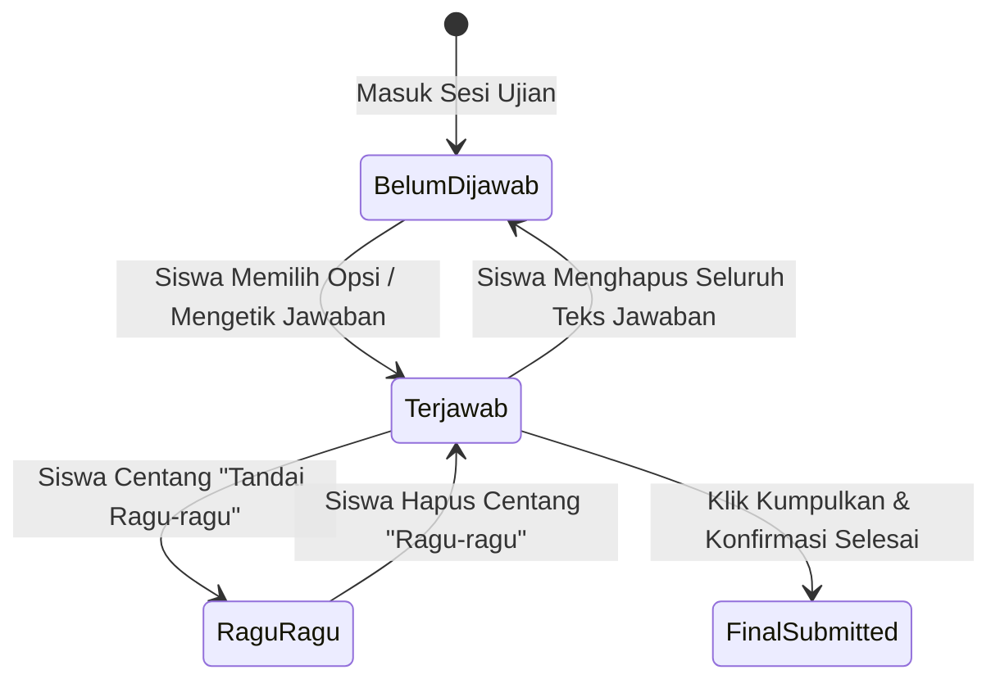

# EXAMIND — UI & UX Design Specifications

**Versi:** 1.0  
**Tanggal:** 31 Agustus 2026  
**Dokumen Induk:** [docs/PRD.md](./PRD.md) | [docs/ARCHITECTURE.md](./ARCHITECTURE.md)  

---

## 1. Prinsip Desain & Design Tokens

EXAMIND mengutamakan antarmuka yang **bebas distraksi, ramah siswa, dan berkejelasan tinggi (high-contrast clarity)** untuk meminimalkan beban kognitif selama ujian berlangsung.

### 1.1 Palet Warna Utama (Color Tokens)

| Token Nama | Kode Hex | Peruntukan UI |
|---|---|---|
| `primary-blue` | `#2563EB` | Warna utama tombol aksi, logo, active state |
| `primary-dark` | `#1E40AF` | Hover state, navbar header |
| `success-green` | `#16A34A` | Soal terjawab, kamera aktif, high confidence |
| `warning-yellow` | `#CA8A04` | Soal ragu-ragu, medium confidence, warning flag |
| `danger-red` | `#DC2626` | Low confidence, proctoring alert, waktu kritis (< 5m) |
| `neutral-bg` | `#F8FAFC` | Background halaman |
| `surface-white` | `#FFFFFF` | Card konten, lembar soal |
| `text-main` | `#0F172A` | Teks pertanyaan dan konten utama |
| `text-muted` | `#64748B` | Label sekunder, metadata |

---

## 2. Rincian Antarmuka Siswa (Student Exam Experience)

```
+----------------------------------------------------------------------------------------------------+
| [Logo EXAMIND]  |  UAS Fisika Kuantum  |  ⏱️ 01:15:20  |  [🟢 Cam 1: OK]  [🟢 Cam 2: OK]  |  [👤 Budi] |
+--------------------------------------------------------------------+-------------------------------+
| SOAL NO. 14 / 40                         [Bobot: 15 Poin | Esai]   | NAVIGATOR SOAL                |
+--------------------------------------------------------------------+-------------------------------+
| Jelaskan fenomena efek fotolistrik dan bagaimana teori kuantum     | [01] [02] [03] [04] [05]      |
| Einstein berhasil menerangkan kelemahan teori gelombang klasik!    | [06] [07] [08] [09] [10]      |
|                                                                    | [11] [12] [13] [14*][15]      |
| ------------------------------------------------------------------ | [16] [17] [18] [19] [20]      |
| JAWABAN ANDA:                                                      | ...                           |
| +----------------------------------------------------------------+ | RINGKASAN:                    |
| | Efek fotolistrik adalah peristiwa terlepasnya elektron dari     | | 🟢 Terjawab: 13              |
| | permukaan logam saat disinari cahaya berfrekuensi tertentu...   | | 🟡 Ragu-ragu: 1             |
| |                                                                | | ⚪ Belum Dijawab: 26        |
| +----------------------------------------------------------------+ |                               |
| 💾 Tersimpan otomatis (12:35:10)                                   | [✓] Tandai Ragu-ragu          |
|                                                                    |                               |
| [ < Soal Sebelumnya ]                           [ Soal Selanjutnya > ] | [ Selesai & Kumpulkan ]   |
+--------------------------------------------------------------------+-------------------------------+
```

### 2.1 State Machine Navigasi Soal (Question State Model)



---

## 3. Rincian Antarmuka Guru (Teacher Grading & Review Suite)

Antarmuka *side-by-side* yang memudahkan guru membandingkan jawaban siswa, penilaian AI, rubrik 4 dimensi, dan melakukan override nilai secara instan:

```
+----------------------------------------------------------------------------------------------------+
| EXAMIND  |  Review Jawaban: Budi Santoso  |  Soal No. 14 (Esai)  |  Nilai Total Siswa: 82.5 / 100  |
+--------------------------------------------------------------------+-------------------------------+
| LEMBAR JAWABAN SISWA                                               | EVALUASI ASISTEN AI           |
+--------------------------------------------------------------------+-------------------------------+
| Pertanyaan:                                                        | Status AI: 🟢 High Confidence |
| "Jelaskan fenomena efek fotolistrik dan teori Einstein!"           | Skor Rekomendasi AI: 13.5/15  |
|                                                                    |                               |
| Jawaban Siswa:                                                     | Breakdown Rubrik:             |
| "Efek fotolistrik adalah terlepasnya elektron dari logam ketika    | 1. Konsep Inti: 5.5 / 6.0     |
| disinari foton. Menurut Einstein, cahaya adalah kuantum energi     | 2. Kelengkapan Argumen: 4.0/4.5|
| diskrit E = hf..."                                                 | 3. Terminologi: 2.0 / 2.5     |
|                                                                    | 4. Kejelasan Logika: 2.0 / 2.0|
| ------------------------------------------------------------------ |                               |
| BUKTI PENGAWASAN PROCTORING (Sesi Ini):                            | KOREKSI GURU (OVERRIDE):      |
| [✓] 0 Insiden Pelanggaran Terdeteksi                               | Nilai Final: [ 14.0 ] / 15    |
| Indeks Integritas: 100% (Sangat Baik)                             | Catatan Guru:                 |
|                                                                    | [ Penjelasan sudah sangat   ] |
|                                                                    | [ runtut dan lengkap.       ] |
| [ < Siswa Sebelumnya ]                           [ Siswa Selanjutnya > ] | [ Simpan & Setujui ]    |
+--------------------------------------------------------------------+-------------------------------+
```

---

## 4. Aksesibilitas & Kompatibilitas Layar (WCAG 2.1 AA)

1. **Responsivitas**: Exam Workspace dioptimalkan untuk resolusi desktop/laptop mulai dari `1024x768` hingga `4K`.
2. **Keyboard Navigation**: Siswa dapat berpindah soal menggunakan shortcut keyboard (`Alt + RightArrow` untuk next, `Alt + LeftArrow` untuk prev).
3. **Contrast Ratio**: Rasio kontras teks terhadap latar belakang minimal `4.5:1` untuk memastikan kenyamanan mata siswa selama ujian berdurasi panjang.
