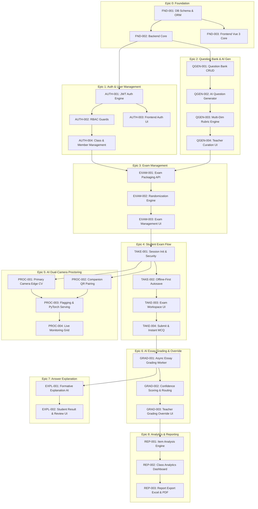

# EXAMIND — Master Ticket Backlog & Engineering Roadmap

**Dokumen Induk:** [docs/PRD.md](../PRD.md) | [docs/SRS.md](../SRS.md) | [docs/ARCHITECTURE.md](../ARCHITECTURE.md) | [docs/UML_SPECIFICATION.md](../UML_SPECIFICATION.md)  
**Tech Stack:** Vue 3 + Vite + Pinia + Vue Router + Tailwind CSS | FastAPI + Pydantic + PyTorch | MySQL (XAMPP)  
**Total Epics:** 9 Epics  
**Total Actionable Tickets:** 28 Tickets  
**Estimasi Total Story Points:** 168 SP  

---

## 1. Peta Ketergantungan Antar Ticket (Dependency Graph)

---

## 2. Tabel Master Backlog Tiket (28 Tickets)

| ID Tiket | Epic | Judul Tiket | Prioritas | SP | Assignee Role |
|---|---|---|---|---|---|
| [`FND-001`](./EPIC-0-FOUNDATION/FND-001-database-schema-orm.md) | Epic 0 | Database Schema, SQLAlchemy 2.0 Models & Seeders | P0 | 5 | Backend |
| [`FND-002`](./EPIC-0-FOUNDATION/FND-002-backend-fastapi-core.md) | Epic 0 | FastAPI Backend Core Architecture & Middleware | P0 | 3 | Backend |
| [`FND-003`](./EPIC-0-FOUNDATION/FND-003-frontend-vue3-core.md) | Epic 0 | Frontend Vue 3 Architecture, Vite, Pinia & Base Views | P0 | 5 | Frontend |
| [`AUTH-001`](./EPIC-1-AUTH/AUTH-001-jwt-authentication-backend.md) | Epic 1 | JWT Authentication & Bcrypt Password Hashing Engine | P0 | 5 | Backend |
| [`AUTH-002`](./EPIC-1-AUTH/AUTH-002-rbac-authorization-guards.md) | Epic 1 | Role-Based Access Control (RBAC) Security Guards | P1 | 3 | Backend |
| [`AUTH-003`](./EPIC-1-AUTH/AUTH-003-frontend-auth-pages-state.md) | Epic 1 | Frontend Auth Pages, State Store & Route Guards | P1 | 5 | Frontend |
| [`AUTH-004`](./EPIC-1-AUTH/AUTH-004-class-and-member-management.md) | Epic 1 | Class & Student Membership Management CRUD | P1 | 5 | Full-Stack |
| [`QGEN-001`](./EPIC-2-QUESTION-GENERATOR/QGEN-001-question-bank-crud.md) | Epic 2 | Question Bank & Items CRUD API | P0 | 5 | Backend |
| [`QGEN-002`](./EPIC-2-QUESTION-GENERATOR/QGEN-002-ai-question-generator-engine.md) | Epic 2 | AI Question Generator Engine (LLM Adapter) | P1 | 8 | AI / Backend |
| [`QGEN-003`](./EPIC-2-QUESTION-GENERATOR/QGEN-003-multi-dimensional-rubric-engine.md) | Epic 2 | Multi-Dimensional Rubric Generator for Essay | P1 | 5 | AI / Backend |
| [`QGEN-004`](./EPIC-2-QUESTION-GENERATOR/QGEN-004-teacher-curation-ui.md) | Epic 2 | Teacher Question Curation & Distractor Review UI | P1 | 8 | Frontend |
| [`EXAM-001`](./EPIC-3-EXAM-MANAGEMENT/EXAM-001-exam-packaging-scheduling-api.md) | Epic 3 | Exam Packaging & Scheduling Management API | P0 | 5 | Backend |
| [`EXAM-002`](./EPIC-3-EXAM-MANAGEMENT/EXAM-002-randomization-engine.md) | Epic 3 | Question & Option Randomization Engine | P2 | 3 | Backend |
| [`EXAM-003`](./EPIC-3-EXAM-MANAGEMENT/EXAM-003-teacher-exam-management-ui.md) | Epic 3 | Teacher Exam Creation & Scheduling Wizard UI | P1 | 8 | Frontend |
| [`TAKE-001`](./EPIC-4-STUDENT-EXAM-FLOW/TAKE-001-session-initialization-security.md) | Epic 4 | Student Session Initialization & Security Check | P0 | 5 | Backend |
| [`TAKE-002`](./EPIC-4-STUDENT-EXAM-FLOW/TAKE-002-offline-first-autosave-engine.md) | Epic 4 | Offline-First Autosave Engine (IndexedDB + Sync) | P0 | 8 | Full-Stack |
| [`TAKE-003`](./EPIC-4-STUDENT-EXAM-FLOW/TAKE-003-student-exam-workspace-ui.md) | Epic 4 | Student Exam Workspace UI & Matrix Navigator | P0 | 8 | Frontend |
| [`TAKE-004`](./EPIC-4-STUDENT-EXAM-FLOW/TAKE-004-submission-pipeline-instant-mcq.md) | Epic 4 | Exam Submission Pipeline & Instant MCQ Evaluator | P0 | 5 | Backend |
| [`PROC-001`](./EPIC-5-AI-PROCTORING/PROC-001-primary-camera-edge-cv.md) | Epic 5 | Primary Camera Edge Vision Engine (MediaPipe) | P1 | 8 | Frontend/CV |
| [`PROC-002`](./EPIC-5-AI-PROCTORING/PROC-002-companion-qr-pairing-stream.md) | Epic 5 | Secondary Camera Companion QR Pairing & Stream | P1 | 8 | Full-Stack |
| [`PROC-003`](./EPIC-5-AI-PROCTORING/PROC-003-proctoring-flagging-storage-api.md) | Epic 5 | Proctoring Incident Flagging & PyTorch Serving API | P1 | 5 | Backend |
| [`PROC-004`](./EPIC-5-AI-PROCTORING/PROC-004-teacher-live-monitoring-grid.md) | Epic 5 | Teacher Live Monitoring Grid & Broadcast Alert | P1 | 8 | Full-Stack |
| [`GRAD-001`](./EPIC-6-ESSAY-GRADING-OVERRIDE/GRAD-001-async-essay-grading-worker.md) | Epic 6 | Async Background AI Essay Grading Worker & ML Pipeline | P0 | 8 | AI / Backend |
| [`GRAD-002`](./EPIC-6-ESSAY-GRADING-OVERRIDE/GRAD-002-confidence-scoring-routing.md) | Epic 6 | AI Confidence Scoring Algorithm & Routing | P1 | 5 | AI / Backend |
| [`GRAD-003`](./EPIC-6-ESSAY-GRADING-OVERRIDE/GRAD-003-teacher-grading-override-ui.md) | Epic 6 | Teacher Grading Review & Override Suite UI | P1 | 8 | Frontend |
| [`EXPL-001`](./EPIC-7-ANSWER-EXPLANATION/EXPL-001-formative-explanation-generator.md) | Epic 7 | Formative Answer Explanation AI Generator | P2 | 5 | AI / Backend |
| [`EXPL-002`](./EPIC-7-ANSWER-EXPLANATION/EXPL-002-student-results-explanation-ui.md) | Epic 7 | Student Results & Concept Explanation Review UI | P2 | 5 | Frontend |
| [`REP-001`](./EPIC-8-ANALYTICS-REPORTING/REP-001-item-analysis-difficulty-discrimination.md) | Epic 8 | Item Analysis Engine (Difficulty & Discrimination) | P2 | 5 | Backend |
| [`REP-002`](./EPIC-8-ANALYTICS-REPORTING/REP-002-class-analytics-dashboard.md) | Epic 8 | Class Analytics Dashboard & Distribution Graphs | P2 | 5 | Frontend |
| [`REP-003`](./EPIC-8-ANALYTICS-REPORTING/REP-003-report-export-excel-pdf.md) | Epic 8 | Official Report Exporter (Excel & PDF Berita Acara) | P2 | 5 | Backend |
